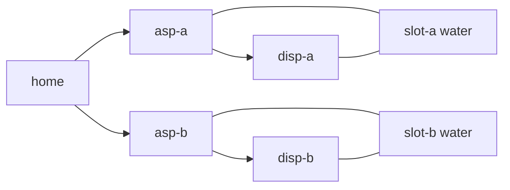

# `.pro`

A `.pro` file is a biomedical procedure graph that agents can read and write. A group acts on robotic steps while the environment is stable; a sheaf restricts the graph when hardware, operators, or constraints change, and each realtime cycle returns a specification rather than commanding hardware.

```toml
[pro]
media_type = "text/vnd.pro+markdown"
extension  = ".pro"
version    = "1.0.0"

[form]
domain         = "bio/med"
fields         = ["robotic", "synthetic"]
autonomous     = true
representation = "group"
object         = "graph"

[pipeline]
input   = "procedure, environment { updates, constraints, operators, hardware }, proposal"
process = "Loop(SENSE, graph.process, ACT) { invent-auto-procedure | adapt-procedure-locally }"
output  = "new specification | current specification"
users   = "agents"
```

## 1. Axioms

1. **Superset & traversal.** Every CommonMark `.md` or OpenGigantic `.og` file is a valid `.pro` link graph. Entry is `::index`; `:requires` loads a dependency; `::warning` is never skipped; `scope` gates visibility; graphs compose across `uri#id` edges. For a procedure instance, the unique `version` with `current=true` is the read endpoint.
2. **Object & fields.** A procedure is a finite directed graph. A `step` has field `robotic` or `synthetic`; `:couples` is their only cross-field edge. A synthetic slot has `payload-class` `empty` or `water`. Volume, unit, and vessel are inert fixture attributes, not rewrite targets.
3. **Rewrite group.** In one stable environment, an autonomous write is the right action of the group presented by the file. Identity is a read. The canonical group is the Klein four-group generated by the commuting involutions `toggle-a` and `toggle-b`; each toggle moves one channel's aspirate and dispense steps together.
4. **Environment sheaf.** Hardware induces the finite site `none <= a <= ab` and `none <= b <= ab`. A section is a three-bit marking `(A, B, home)`. Restriction is contravariant, functorial, idempotent, and can only turn channel bits off. Compatible local sections glue uniquely; disagreement on their shared `home` bit has no glue.
5. **Realtime loop.** One cycle senses one environment tuple and one proposal, processes exactly one admission class, and acts once. A read or refusal appends a trace event but no version. A write appends one immutable version naming its parent.
6. **Local adaptation.** If hardware descends to an open `V <= U`, or constraints or operators change on the same open, `adapt-procedure-locally` computes the candidate restriction first. If the sensed operators cover that candidate and the sensed constraints accept it, `restrict` preempts and discards the proposal. Hardware expansion or an incomparable open has no canonical extension and holds the version; a failed operator or constraint check also holds it.
7. **Version algebra.** A toggle version stores its generator as `inverse`. A restriction is not a group element: its `inverse` is absent, rollback is its parent, and its relative group element resets to `e`. Equality of words, group elements, sections, and version chains are four different relations.
8. **Scope & domain.** `agent` and `orchestrator` are recorded scopes, not privilege escalation. The manifest attribute vocabulary is closed and has no attribute for a sequence, organism, strain, toxin, patient identifier, diagnosis, treatment, or administration. The same malformed proposal is refused in either scope.
9. **Output boundary.** `ACT` returns the new specification after an admitted write, or the current specification after a read or refusal. It never operates a robot, executes a laboratory protocol, or authorizes clinical use. [DISCLAIMER](DISCLAIMER) governs every read.

## 2. Ontology & Rewrite Algebra (`lean`)

| Node | Role | Edge | Role |
|---|---|---|---|
| `procedure` | Graph root; names current version | `:contains` | Child vertex |
| `step` | Robotic motion or synthetic slot | `:precedes` | Robotic partial order |
| `gate` | Section, payload, or admission check | `:couples` | Robotic step to synthetic slot |
| `transform` | Group, generator, or restriction | `:acts` | Group generator acting on a version |
| `environment` | Updates, constraints, operators, hardware | `:restricts` | Local restriction to an environment |
| `version` | Immutable snapshot and parent link | `:writes` | Transform to produced version |
| `invariant` | Safety or conformance check | `:senses` | Version to recorded environment |
| `meta` | Trace or `__view` | `:inverts` | Generator to its inverse |
|  |  | `:supersedes` | Version to parent |
|  |  | `:requires` | Gate or check dependency |

The canonical rewrite group is

`V4 = < toggle-a, toggle-b | toggle-a^2 = toggle-b^2 = e, toggle-a * toggle-b = toggle-b * toggle-a >`.

The action is on the right: generators apply in time order and the latest generator is the right factor, so `act(g * h, p) = act(h, act(g, p))`. The group is abelian, but the ordered version chain is not erased.

```lean
inductive G | e | a | b | ab
  deriving DecidableEq, Repr

def mul : G → G → G
  | .e, g => g
  | g, .e => g
  | .a, .a => .e
  | .a, .b => .ab
  | .a, .ab => .b
  | .b, .a => .ab
  | .b, .b => .e
  | .b, .ab => .a
  | .ab, .a => .b
  | .ab, .b => .a
  | .ab, .ab => .e

def act (g : G) (p : Bool × Bool) : Bool × Bool :=
  match g, p with
  | .e, p => p
  | .a, (x, y) => (!x, y)
  | .b, (x, y) => (x, !y)
  | .ab, (x, y) => (!x, !y)

def groupAll : Bool :=
  let gs : List G := [.e, .a, .b, .ab]
  gs.all fun g =>
    mul .e g == g && mul g .e == g && mul g g == .e &&
    gs.all fun h =>
      mul g h == mul h g &&
      gs.all fun k => mul (mul g h) k == mul g (mul h k)

def actionAll : Bool :=
  let gs : List G := [.e, .a, .b, .ab]
  let bs : List Bool := [false, true]
  gs.all fun g => gs.all fun h =>
    bs.all fun x => bs.all fun y =>
      act (mul g h) (x, y) == act h (act g (x, y))

theorem v4_laws :
    groupAll = true ∧
    actionAll = true ∧
    mul .a .b = .ab ∧
    act .ab (true, false) = (false, true) ∧
    act .b (act .a (true, true)) = act .a (act .b (true, true)) := by decide
```

The hardware site and restriction sheaf are finite. `home` is a global bit that every restriction preserves; conforming procedure versions additionally require it to be true.

```lean
inductive Open | none | oa | ob | ab
  deriving DecidableEq, Repr

def le : Open → Open → Bool
  | .none, _ => true
  | .oa, .oa => true
  | .oa, .ab => true
  | .ob, .ob => true
  | .ob, .ab => true
  | .ab, .ab => true
  | _, _ => false

structure Sec where
  armA : Bool
  armB : Bool
  home : Bool
  deriving DecidableEq, Repr

def restrict (v : Open) (s : Sec) : Sec :=
  { armA := s.armA && le .oa v
  , armB := s.armB && le .ob v
  , home := s.home }

def supported (v : Open) (s : Sec) : Bool :=
  (!s.armA || le .oa v) && (!s.armB || le .ob v)

def glue (sa sb : Sec) : Option Sec :=
  match sa.armB, sb.armA, sa.home == sb.home with
  | false, false, true => some { armA := sa.armA, armB := sb.armB, home := sa.home }
  | _, _, _ => none

def functorial : Bool :=
  let os : List Open := [.none, .oa, .ob, .ab]
  let bs : List Bool := [false, true]
  os.all fun u => os.all fun v => os.all fun w =>
    bs.all fun a => bs.all fun b => bs.all fun h =>
      let s : Sec := { armA := a, armB := b, home := h }
      (!(le w v && le v u) || restrict w (restrict v s) == restrict w s) &&
      restrict v (restrict v s) == restrict v s &&
      supported v (restrict v s)

def reconstruct : Bool :=
  let bs : List Bool := [false, true]
  bs.all fun a => bs.all fun b => bs.all fun h =>
    let s : Sec := { armA := a, armB := b, home := h }
    glue (restrict .oa s) (restrict .ob s) == some s

def sFull : Sec := { armA := true, armB := true, home := true }

theorem sheaf_laws :
    functorial = true ∧
    reconstruct = true ∧
    le .oa .ab = true ∧
    le .ab .oa = false ∧
    restrict .oa sFull = { armA := true, armB := false, home := true } ∧
    glue (restrict .oa sFull) (restrict .ob sFull) = some sFull ∧
    glue { armA := true, armB := false, home := true }
         { armA := false, armB := true, home := false } = none := by decide
```

`toggle-a` then `toggle-b` and the swapped word both denote `ab` and end at `(A off, B off)`, but their words remain distinct. Order becomes observationally non-commutative across adaptation: `toggle-b` then restriction to `a` writes two descendants, whereas restriction to `a` then `toggle-b` writes one descendant and refuses the second proposal; both finish at `(A on, B off)`.

## 3. Grammar (`~EBNF`)

```ebnf
pro          = markdown_raw | manifest , { node_block | markdown_prose } ;
manifest     = "::meta"   , NL , { kv_line } , "::end" , NL ,
               "::schema" , NL , { kv_line } , "::end" , NL ,
               "::index"  , NL , { "#" , TEXT_LINE , NL | index_row } , "::end" , NL ;
kv_line      = id , ":" , WS , TEXT_LINE , NL ;
index_row    = id , WS , "|" , WS , node_type , WS , "|" , WS , scope , WS , "|" , WS , TEXT_LINE , NL ;
node_block   = "::node" , WS , "[" , attr , { WS , attr } , "]" , NL ,
               "::dense" , ( WS , TEXT_LINE , NL | NL , TEXT_LINE , NL , "::end" , NL ) ,
               { edge_decl | "::edges" , NL , { edge_decl } , "::end" , NL |
                 fenced_code | colon_block } ,
               "::end" , NL ;
attr         = attr_key , "=" , ( STRING | [ "-" ] , NUMBER | "true" | "false" | id_list ) ;
attr_key     = "id" | "type" | "scope" | "entry" | "current" | "field" | "operator" |
               "hardware" | "payload-class" | "volume" | "unit" | "vessel" | "kind" |
               "presentation" | "element" | "writer" | "parent" | "anchor" | "transform" |
               "inverse" | "rel" | "open" | "enabled" ;
id_list      = id , { "," , id } ;
node_type    = "procedure" | "step" | "gate" | "transform" | "environment" |
               "version" | "invariant" | "meta" ;
scope        = "all" | "agent" | "orchestrator" ;
fenced_code  = "```" , ( "tla" | "lean" | "mermaid" | id ) , NL , VERBATIM , "```" , NL ;
colon_block  = "::" , id , [ WS , "[" , attr , { WS , attr } , "]" ] , NL ,
               VERBATIM , "::end" , NL ;
edge_decl    = ( "->" | "<-" | "<>" ) , "[:" , edge_type , { WS , attr } , "]" ,
               WS , target , { "," , [ WS ] , target } , NL ;
edge_type    = "contains" | "requires" | "precedes" | "couples" | "acts" |
               "restricts" | "inverts" | "writes" | "senses" | "supersedes" ;
target       = [ URI_PATH , "#" ] , id ;
id           = ( LETTER | "_" ) , { LETTER | DIGIT | "_" | "-" } ;
```

The closed `attr_key` production applies to a manifested procedure graph. Raw CommonMark remains a valid link graph under the superset axiom, but it does not become a procedure version and cannot be selected by `current=true`.

## 4. Realtime & Local Adaptation Logic (`tla`)

The realtime loop uses four independent inputs: `updates`, `constraints`, `operators`, and `hardware`, plus one proposal. Hardware derives the sensed open. Updates are trace data; an updates-only sense is a read. Constraints and operators are snapshot state and are checked against the candidate marking.

Stable admission is closed. The operator and constraint checks apply to the proposal's resulting marking, not only to the current marking:

| Proposal | Open | Result |
|---|---|---|
| `id` or `restrict` | any stable open | read |
| `toggle-a` | `a`, `ab` | write `toggle-a` |
| `toggle-a` | `none`, `b` | `not-admitted` |
| `toggle-b` | `b`, `ab` | write `toggle-b` |
| `toggle-b` | `none`, `a` | `not-admitted` |
| any other name | any | `ill-formed` |
| any proposal requiring a payload outside `empty`, `water` | any | `ill-formed` |

Adaptation preempts this table. For sensed open `V` and current open `U`:

- `V <= U`: compute `q = restrict(V, current)`, then append one `restrict` version iff sensed operators cover `q` and sensed constraints accept `q`;
- `V` larger than or incomparable with `U`: return `no-extension` and hold the version;
- failed operator or constraint check: return `ill-formed-environment` and hold the version;
- unchanged snapshot: use the stable table.

```tla
---- MODULE ProKernel ----
EXTENDS Integers, FiniteSets, Sequences

Opens     == {"none", "a", "b", "ab"}
Ops       == {"home", "aspirate", "dispense"}
Policies  == {"pairing", "single"}
Transforms == {"id", "toggle-a", "toggle-b", "restrict"}
Relations  == {"e", "a", "b", "ab"}
Events == {
  "init", "read", "write-toggle-a", "write-toggle-b", "write-restrict",
  "ill-formed", "not-admitted", "ill-formed-environment", "no-extension"
}

Le(v, u) ==
  \/ v = "none"
  \/ v = "a"  /\ u \in {"a", "ab"}
  \/ v = "b"  /\ u \in {"b", "ab"}
  \/ v = "ab" /\ u = "ab"

HasA(u) == u \in {"a", "ab"}
HasB(u) == u \in {"b", "ab"}

Restrict(v, x, y) ==
  <<IF x = 1 /\ HasA(v) THEN 1 ELSE 0,
    IF y = 1 /\ HasB(v) THEN 1 ELSE 0>>

Supported(u, x, y) ==
  /\ x \in 0..1
  /\ y \in 0..1
  /\ (x = 0 \/ HasA(u))
  /\ (y = 0 \/ HasB(u))

Covers(os, x, y) ==
  /\ "home" \in os
  /\ ((x = 1 \/ y = 1) => {"aspirate", "dispense"} \subseteq os)

PolicyOK(p, x, y) ==
  CASE p = "pairing" -> TRUE
    [] p = "single"  -> x + y <= 1

Mul(g, h) ==
  CASE g = "e" -> h
    [] h = "e" -> g
    [] g = h -> "e"
    [] {g, h} = {"a", "b"} -> "ab"
    [] {g, h} = {"a", "ab"} -> "b"
    [] {g, h} = {"b", "ab"} -> "a"

VARIABLES open, a, b, ops, policy, version, priorVersion,
          parentA, parentB, transform, rel, event

vars == <<open, a, b, ops, policy, version, priorVersion,
          parentA, parentB, transform, rel, event>>

TypeOK ==
  /\ open \in Opens
  /\ a \in 0..1
  /\ b \in 0..1
  /\ ops \in SUBSET Ops
  /\ policy \in Policies
  /\ version \in 0..3
  /\ priorVersion \in 0..3
  /\ parentA \in 0..1
  /\ parentB \in 0..1
  /\ transform \in Transforms
  /\ rel \in Relations
  /\ event \in Events

SectionOK    == Supported(open, a, b)
OperatorOK   == Covers(ops, a, b)
ConstraintOK == PolicyOK(policy, a, b)

VersionLaw ==
  /\ (event = "init" => version = 0 /\ priorVersion = 0)
  /\ (event \in {"read", "ill-formed", "not-admitted",
                  "ill-formed-environment", "no-extension"}
      => version = priorVersion)
  /\ (event \in {"write-toggle-a", "write-toggle-b", "write-restrict"}
      => version = priorVersion + 1)

ParentLaw ==
  /\ (transform = "id" => version = 0)
  /\ (transform = "toggle-a" => parentA = 1 - a /\ parentB = b)
  /\ (transform = "toggle-b" => parentA = a /\ parentB = 1 - b)
  /\ (transform = "restrict" => a <= parentA /\ b <= parentB /\ rel = "e")

Init ==
  /\ open = "ab"
  /\ a = 1
  /\ b = 1
  /\ ops = Ops
  /\ policy = "pairing"
  /\ version = 0
  /\ priorVersion = 0
  /\ parentA = 1
  /\ parentB = 1
  /\ transform = "id"
  /\ rel = "e"
  /\ event = "init"

ToggleA ==
  /\ version < 3
  /\ HasA(open)
  /\ Covers(ops, 1 - a, b)
  /\ PolicyOK(policy, 1 - a, b)
  /\ parentA' = a
  /\ parentB' = b
  /\ a' = 1 - a
  /\ b' = b
  /\ version' = version + 1
  /\ priorVersion' = version
  /\ transform' = "toggle-a"
  /\ rel' = Mul(rel, "a")
  /\ event' = "write-toggle-a"
  /\ UNCHANGED <<open, ops, policy>>

ToggleB ==
  /\ version < 3
  /\ HasB(open)
  /\ Covers(ops, a, 1 - b)
  /\ PolicyOK(policy, a, 1 - b)
  /\ parentA' = a
  /\ parentB' = b
  /\ a' = a
  /\ b' = 1 - b
  /\ version' = version + 1
  /\ priorVersion' = version
  /\ transform' = "toggle-b"
  /\ rel' = Mul(rel, "b")
  /\ event' = "write-toggle-b"
  /\ UNCHANGED <<open, ops, policy>>

Adapt(v, newOps, newPolicy) ==
  /\ version < 3
  /\ v \in Opens
  /\ newOps \in SUBSET Ops
  /\ newPolicy \in Policies
  /\ Le(v, open)
  /\ <<v, newOps, newPolicy>> # <<open, ops, policy>>
  /\ LET q == Restrict(v, a, b)
     IN /\ Covers(newOps, q[1], q[2])
        /\ PolicyOK(newPolicy, q[1], q[2])
        /\ parentA' = a
        /\ parentB' = b
        /\ a' = q[1]
        /\ b' = q[2]
  /\ open' = v
  /\ ops' = newOps
  /\ policy' = newPolicy
  /\ version' = version + 1
  /\ priorVersion' = version
  /\ transform' = "restrict"
  /\ rel' = "e"
  /\ event' = "write-restrict"

Hold(e) ==
  /\ priorVersion' = version
  /\ event' = e
  /\ UNCHANGED <<open, a, b, ops, policy, version,
                 parentA, parentB, transform, rel>>

Read              == Hold("read")
RefuseIllFormed   == Hold("ill-formed")
RefuseNotAdmitted == /\ open \in {"none", "a", "b"} /\ Hold("not-admitted")
RefuseNoExtension(v) == /\ v \in Opens /\ ~Le(v, open) /\ Hold("no-extension")

RefuseEnvironment(v, newOps, newPolicy) ==
  /\ v \in Opens
  /\ newOps \in SUBSET Ops
  /\ newPolicy \in Policies
  /\ Le(v, open)
  /\ <<v, newOps, newPolicy>> # <<open, ops, policy>>
  /\ LET q == Restrict(v, a, b)
     IN ~Covers(newOps, q[1], q[2]) \/ ~PolicyOK(newPolicy, q[1], q[2])
  /\ Hold("ill-formed-environment")

Next ==
  \/ ToggleA
  \/ ToggleB
  \/ \E v \in Opens, os \in SUBSET Ops, p \in Policies : Adapt(v, os, p)
  \/ Read
  \/ RefuseIllFormed
  \/ RefuseNotAdmitted
  \/ \E v \in Opens : RefuseNoExtension(v)
  \/ \E v \in Opens, os \in SUBSET Ops, p \in Policies :
       RefuseEnvironment(v, os, p)

Spec == Init /\ [][Next]_vars
====
```

`TypeOK`, `SectionOK`, `OperatorOK`, `ConstraintOK`, `VersionLaw`, and `ParentLaw` are invariants. The finite check bounds versions at `3`; this is a model-checking bound, not a format limit.

## 5. Canonical Instantiation (`CAL-1937-001`)

`CAL-1937-001` is a synthetic two-channel water-calibration graph. It starts with channels A and B enabled; a channel-B hardware fault restricts it to open `a`, and a later `toggle-a` leaves only `home` enabled.

````markdown
::meta
title: CAL-1937-001
version: 1.0.0
fixture: CAL-1937-001
domain: bio/med
fields: robotic|synthetic
scope: all
::end

::schema
node-types: [procedure, step, gate, transform, environment, version, invariant, meta]
edge-types: [contains, requires, precedes, couples, acts, restricts, inverts, writes, senses, supersedes]
fields: [robotic, synthetic]
opens: [none, a, b, ab]
payload-classes: [empty, water]
scopes: [all, agent, orchestrator]
::end

::index
# id | type | scope | keywords
proc | procedure | all | calibration, water, two-channel, current=ver-2
grp-v4 | transform | all | group, V4, toggle-a, toggle-b
tx-a | transform | all | generator, a, inverse
tx-b | transform | all | generator, b, inverse
tx-restrict | transform | all | sheaf, restriction, no-inverse
env-0 | environment | all | hardware A B, open ab
env-1 | environment | all | hardware A, channel-b-fault, open a
step-home | step | all | home, robotic
step-asp-a | step | all | aspirate, A
step-disp-a | step | all | dispense, A
step-asp-b | step | all | aspirate, B
step-disp-b | step | all | dispense, B
slot-a | step | all | water, synthetic
slot-b | step | all | water, synthetic
gate-section | gate | all | support, pairing
gate-payload | gate | all | empty, water
inv-runtime | invariant | all | one-transform, supported, operator-cover
ver-0 | version | all | anchor, open ab
ver-1 | version | all | restrict, open a
ver-2 | version | all | toggle-a, current
trace | meta | all | cycles, refusals
__view | meta | all | mermaid, stateDiagram-v2
::end

::node [id=proc type=procedure scope=all entry=true current=ver-2]
::dense CAL-1937-001|water-calibration|group=V4|sheaf=hardware
::warning
Read DISCLAIMER before any node. ACT returns a specification; it does not command hardware.
::end
->[:contains] grp-v4, tx-restrict, env-0, env-1, step-home, step-asp-a, step-disp-a, step-asp-b, step-disp-b, slot-a, slot-b, gate-section, gate-payload, inv-runtime, ver-0, ver-1, ver-2, trace, __view
::end

::node [id=grp-v4 type=transform scope=all kind=group presentation=V4]
::dense e,a,b,ab|a^2=b^2=e|ab=ba|right-action
->[:contains] tx-a, tx-b
::end

::node [id=tx-a type=transform scope=all kind=generator element=a inverse=tx-a]
::dense toggle-a|moves asp-a+disp-a together
->[:inverts] tx-a
->[:acts] ver-1
->[:writes] ver-2
::end

::node [id=tx-b type=transform scope=all kind=generator element=b inverse=tx-b]
::dense toggle-b|moves asp-b+disp-b together
->[:inverts] tx-b
::end

::node [id=tx-restrict type=transform scope=all kind=sheaf inverse=none]
::dense adapt-procedure-locally|not-group-element|rollback=parent
->[:restricts] env-1
->[:writes] ver-1
::end

::node [id=env-0 type=environment scope=all open=ab]
::dense hardware=A,B|operators=home,aspirate,dispense|constraints=channels-not-isomorphic|updates=empty
::end

::node [id=env-1 type=environment scope=all open=a]
::dense hardware=A|operators=home,aspirate,dispense|constraints=channels-not-isomorphic|updates=channel-b-fault
::end

::node [id=step-home type=step scope=all field=robotic operator=home hardware=none]
::dense home|enabled in every conforming version
->[:precedes] step-asp-a, step-asp-b
::end

::node [id=step-asp-a type=step scope=all field=robotic operator=aspirate hardware=a]
::dense aspirate-a|paired-with=dispense-a
->[:precedes] step-disp-a
->[:couples] slot-a
::end

::node [id=step-disp-a type=step scope=all field=robotic operator=dispense hardware=a]
::dense dispense-a|paired-with=aspirate-a
->[:couples] slot-a
::end

::node [id=step-asp-b type=step scope=all field=robotic operator=aspirate hardware=b]
::dense aspirate-b|paired-with=dispense-b
->[:precedes] step-disp-b
->[:couples] slot-b
::end

::node [id=step-disp-b type=step scope=all field=robotic operator=dispense hardware=b]
::dense dispense-b|paired-with=aspirate-b
->[:couples] slot-b
::end

::node [id=slot-a type=step scope=all field=synthetic payload-class=water volume=10 unit=uL vessel=calibration-plate]
::dense slot-a|water|inert
::end

::node [id=slot-b type=step scope=all field=synthetic payload-class=water volume=10 unit=uL vessel=calibration-plate]
::dense slot-b|water|inert
::end

::node [id=gate-section type=gate scope=all]
::dense enabled-hardware-in-open|aspirate+dispense move as one channel bit
::warning
A step outside the sensed open is dropped, never retargeted. Channels A and B are not interchangeable.
::end
->[:requires] env-0, env-1
::end

::node [id=gate-payload type=gate scope=all]
::dense payload-class in empty,water|closed attribute vocabulary
::warning
The format has no attribute for a sequence, organism, strain, toxin, patient identifier, diagnosis, treatment, or administration. Orchestrator scope adds none.
::end
::end

::node [id=inv-runtime type=invariant scope=all]
::dense one-cycle-one-admission|home=true|section-supported|operators-cover|restriction-monotone
->[:requires] gate-section, gate-payload
::end

::node [id=ver-0 type=version scope=all current=false writer=none parent=none anchor=ver-0 transform=id inverse=none rel=e open=ab enabled=step-home,step-asp-a,step-disp-a,step-asp-b,step-disp-b]
::dense A=on|B=on|anchor
->[:senses] env-0
::end

::node [id=ver-1 type=version scope=all current=false writer=agent parent=ver-0 anchor=ver-1 transform=restrict inverse=none rel=e open=a enabled=step-home,step-asp-a,step-disp-a]
::dense A=on|B=off|rollback=ver-0
::warning
Channel B is outside open a. Do not move step-asp-b or step-disp-b onto channel A.
::end
->[:senses] env-1
->[:supersedes] ver-0
::end

::node [id=ver-2 type=version scope=all current=true writer=agent parent=ver-1 anchor=ver-1 transform=toggle-a inverse=tx-a rel=a open=a enabled=step-home]
::dense A=off|B=off|slots-retained|couples-inactive
->[:senses] env-1
->[:supersedes] ver-1
::end

::node [id=trace type=meta scope=all]
::dense five-cycles|two-writes|two-scope-equal-refusals
::table
cycle|sense|proposal|witness|version
0|env-0 stable|id|read|ver-0
1|env-1 descends|toggle-a|write:restrict (proposal discarded)|ver-1
2|env-1 stable|toggle-a|write:toggle-a|ver-2
3|env-1 stable|other, agent|ill-formed|ver-2 held
4|env-1 stable|other, orchestrator|ill-formed|ver-2 held
::end
::end

::node [id=__view type=meta scope=all]
::dense version-chain|type-graph-is-not-current-marking

```mermaid
stateDiagram-v2
  direction LR
  [*] --> Ver0: open ab; A on; B on
  Ver0 --> Ver1: restrict to open a
  Ver1 --> Ver2: toggle-a
  Ver2 --> Ver2: other refused in either scope
```


::end
````


The type graph retains both channels and both synthetic slots. The current marking is `ver-2`, which enables `step-home` only. `act(a)` maps `ver-1` to `ver-2`, and the same generator restores `ver-1`; restriction from `ver-0` to `ver-1` has no group inverse.

## 6. Falsification

Each row is a challenge. The failure signal is what a conforming read returns.

| Challenge | Failure signal |
|---|---|
| Store a toggle version without its generator inverse | The manifested graph is non-conformant. |
| Restrict to open `a` twice and expect B to return | The second restriction equals the first; B stays off. |
| Expand from `a` to `ab` by calling restriction | `Le(ab, a) = false`; result is `no-extension` and the version holds. |
| Move from open `a` to incomparable open `b` without a supplied compatible section | There is no canonical extension; the version holds. |
| Remove `dispense` while A remains enabled | The candidate fails operator coverage; result is `ill-formed-environment`. |
| Remove B hardware and B-only work while the generic operator set still covers A | Restriction succeeds; B's aspirate and dispense are both dropped. |
| Let proposal `other` block a valid hardware descent | Adaptation preempts it; the write is `restrict`. |
| Treat `toggle-a; toggle-b` and `toggle-b; toggle-a` as different elements | Both products are `ab` and both sections are `(off, off)`; their words differ. |
| Treat `toggle-b; restrict(a)` and `restrict(a); toggle-b` as one chain | First path has two writes; second has one write then `not-admitted`; final bits agree, chains do not. |
| Read `rel=e` after restriction as “no earlier toggle occurred” | The parent chain retains earlier transforms; only the relative product restarted. |
| Retarget a B step onto A | Non-conformant: restriction drops and never retargets; `channels-not-isomorphic` remains in force. |
| Glue local sections whose `home` bits differ | `glue` returns `none`; no version is appended. |
| Add a sequence, organism, strain, toxin, patient identifier, diagnosis, treatment, or administration attribute | The closed `attr_key` grammar rejects the manifest in both scopes. |
| Allocate a version for an updates-only heartbeat | Snapshot state is unchanged; the event is `read`. |
| Admit two transforms in one cycle | The process violates the one-admission transition system. |
| Skip `::warning` | The read is invalid under the traversal axiom. |
| Treat `ACT` as a robot or clinical command | `ACT` returns a specification only; DISCLAIMER governs. |

`v4_laws` exhausts the four group elements and four channel markings. `sheaf_laws` exhausts the four opens and eight bit sections. TLC checks the bounded transition system through version `3`: `TypeOK`, `SectionOK`, `OperatorOK`, `ConstraintOK`, `VersionLaw`, and `ParentLaw` hold with no deadlock.

## References

1. Saunders Mac Lane and Ieke Moerdijk, *Sheaves in Geometry and Logic*, Springer, 1992.
2. Joseph A. Goguen, ["Sheaf Semantics for Concurrent Interacting Objects"](https://doi.org/10.1017/S0960129500001420), *Mathematical Structures in Computer Science* 2 (1992) 159–191.
3. Vincent Danos and Jean Krivine, ["Reversible Communicating Systems"](https://doi.org/10.1007/978-3-540-28644-8_19), CONCUR 2004, LNCS 3170, 292–307.
4. Antoni Mazurkiewicz, ["Introduction to Trace Theory"](https://doi.org/10.1142/9789814261456_0001), in V. Diekert and G. Rozenberg (eds.), *The Book of Traces*, World Scientific, 1995.
5. M. Dubey, [*ObjectGraph* (`arXiv:2604.27820v1`)](https://arxiv.org/html/2604.27820v1), 2026.
6. [CommonMark 0.31.2](https://spec.commonmark.org/0.31.2/).
7. Sibling graph syntax, [wetware-hq/chart](https://github.com/wetware-hq/chart) and [wetware-hq/figure](https://github.com/wetware-hq/figure).

Retrieved 14 Nov 2026 (Australia/Sydney). Representation only.

## License

MIT — see [LICENSE](LICENSE).
