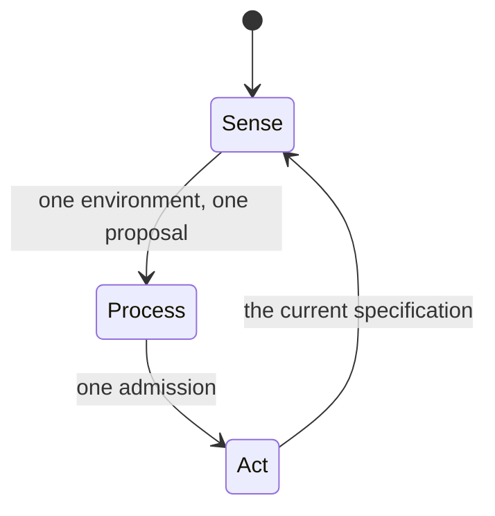
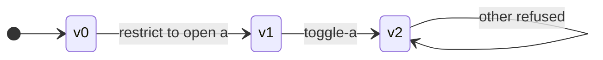

# `.pro`

A `.pro` file is a biomedical procedure graph that an agent can read and write. Inside one environment, a rewrite group acts on the robotic steps; when hardware, operators, or constraints change, a sheaf restricts the graph to that environment. Each cycle senses the environment, admits one transform, and returns a new specification, or returns the current specification when the proposal is refused.

```toml
[pro]
media_type = "text/vnd.pro+markdown"
extension  = ".pro"
version    = "1.0.0"

[pipeline]
input          = "procedure, environment { updates, constraints, operators, hardware }, proposal"
process        = "invent-auto-procedure | adapt-procedure-locally"
output         = "specification .pro { new version | current version }"
users          = "agents"
representation = "group"
object         = "graph"
```

Read [DISCLAIMER](DISCLAIMER) before any node. The traversal index is [ooc/procedure.og](ooc/procedure.og). The normative fixture is [examples/cal-1937-001.pro](examples/cal-1937-001.pro).

## 1. Axioms

1. **Disclaimer.** Read DISCLAIMER before any node. A `::warning` is part of the read.
2. **Object.** A procedure is a finite directed graph. Vertices are steps, gates, transforms, environments, and versions.
3. **Fields.** A step is `robotic` or `synthetic`. A `couples` edge is the only link between them. A synthetic slot has `payload-class` `empty` or `water`.
4. **Group.** Inside one environment, an autonomous edit is the right action of the group the file presents. The identity is a read. The fixture's group is the Klein four-group on `toggle-a` and `toggle-b`.
5. **Sheaf.** A change of open, constraints, or operators is restriction along the hardware site. Restriction drops a component whose hardware has left the open. It does not retarget that component.
6. **Loop.** The user is an agent. One cycle senses one environment tuple and one proposal, admits one transform, and acts. Act returns a specification. Act does not command hardware.
7. **Preempt.** When the open, the constraints, or the operators differ, and the sensed operators still cover the current marking, the admitted transform is `restrict`. The proposal is discarded.
8. **Hold.** When the sensed operators do not cover the current marking, the cycle appends no version.
9. **Scope.** `agent` and `orchestrator` are recorded. They do not change admission and they do not add attributes.
10. **Version.** A new specification is a new version. It names its parent. A read, a refusal, a stable `restrict`, and an updates-only sense append nothing.
11. **Three equalities.** Equality of words, equality of group elements, and equality of sections are three relations. Equal bits are not equal versions.
12. **Domain.** The grammar has no attribute for a sequence, an organism, a strain, or a toxin. A clinical workup belongs in [`.chart`](https://github.com/wetware-hq/chart).

## 2. Ontology

| Node | Role | Edge | Role |
|---|---|---|---|
| `procedure` | Graph root, names the current version | `:contains` | Child vertex |
| `step` | Robotic motion or synthetic slot | `:precedes` | Order of robotic steps |
| `gate` | Section or payload check | `:couples` | Robotic step to synthetic slot |
| `transform` | Group presentation, or restriction | `:restricts` | Restriction to an environment |
| `environment` | Updates, constraints, operators, hardware | `:senses` | Version to the environment it records |
| `version` | Immutable snapshot | `:inverts` | A toggle to itself |
| `meta` | Trace, `__view` | `:writes` | Version produced by a named transform |
|  |  | `:refuses` | Reserved; this version puts refusals in the trace |

A couple is active only while its robotic endpoint is in the version's `enabled` set. Synthetic slots stay in the graph when the couple is inactive. `volume`, `unit`, and `vessel` are fixture attributes. No generator rewrites them.

The open is a function of hardware.

| File open | Hardware | Lean constructor |
|---|---|---|
| `none` | {} | `none` |
| `a` | {A} | `oa` |
| `b` | {B} | `ob` |
| `ab` | {A, B} | `ab` |

## 3. Rewrite group

`invent-auto-procedure` runs when the environment tuple is stable. The admitted writes are words in the presented group.

The fixture presents

⟨ toggle-a, toggle-b | toggle-a² = toggle-b² = e, toggle-a · toggle-b = toggle-b · toggle-a ⟩.

That group is the Klein four-group. Elements are `e`, `a`, `b`, `ab`. Each element is its own inverse. `toggle-a` flips the channel-A bit and leaves channel B and `home` fixed. `toggle-b` flips channel B. A flip moves that channel's aspirate and dispense together. `home` stays enabled.

The action is on the right. Generators apply in time order, and the latest generator is the right factor: `act(g · h, p) = act(h, act(g, p))`. The element on a version is the product of the generators since the last restriction. The group is abelian, so the opposite multiplication order is the same element. The ordered word on the version chain is still recorded. This group does not witness a left-right difference. Order that changes the trace sits in §6, where restriction meets `toggle-b`.

From anchor bits (A on, B on):

| Word | Element | Section |
|---|---|---|
| toggle-a, then toggle-b | `ab` | A off, B off |
| toggle-b, then toggle-a | `ab` | A off, B off |

The second step's inverse restores the parent section. After toggle-a then toggle-b, the parent is (A off, B on), and `act(b)` returns there. The element inverse `ab` restores the anchor (A on, B on), which is the grandparent, not the parent.

```lean
inductive G | e | a | b | ab
  deriving DecidableEq, Repr

def mul : G → G → G
  | .e, g => g
  | g, .e => g
  | .a, .a => .e
  | .a, .b => .ab
  | .a, .ab => .b
  | .b, .a => .ab
  | .b, .b => .e
  | .b, .ab => .a
  | .ab, .a => .b
  | .ab, .b => .a
  | .ab, .ab => .e

def act (g : G) (p : Bool × Bool) : Bool × Bool :=
  match g, p with
  | .e, p => p
  | .a, (x, y) => (Bool.not x, y)
  | .b, (x, y) => (x, Bool.not y)
  | .ab, (x, y) => (Bool.not x, Bool.not y)

theorem v4 :
    mul .a .a = .e ∧
    mul .b .b = .e ∧
    mul .ab .ab = .e ∧
    mul .a .b = .ab ∧
    mul .b .a = .ab ∧
    mul (mul .a .b) .ab = .e ∧
    act .a (act .a (true, true)) = (true, true) ∧
    act .ab (true, false) = (false, true) ∧
    act (mul .a .b) (true, false) = act .b (act .a (true, false)) ∧
    act (mul .a .b) (true, false) = act .a (act .b (true, false)) := by decide

def assocAll : Bool :=
  let gs : List G := [.e, .a, .b, .ab]
  gs.all fun g => gs.all fun h => gs.all fun k =>
    mul (mul g h) k == mul g (mul h k)

def actionAll : Bool :=
  let gs : List G := [.e, .a, .b, .ab]
  let bs : List Bool := [false, true]
  gs.all fun g => gs.all fun h =>
    bs.all fun x => bs.all fun y =>
      act (mul g h) (x, y) == act h (act g (x, y))

theorem carrier : assocAll = true ∧ actionAll = true := by decide
```

`toggle-a` and `toggle-b` are independent in the sense of Mazurkiewicz: adjacent occurrences may be swapped without changing the element or the section. A refusal is not a generator and is not swapped into the word. It stays in the trace.

## 4. Grammar

```ebnf
pro          = manifest , { node_block } ;
manifest     = meta_block , schema_block , index_block ;
meta_block   = "::meta" , NL , { kv_line } , "::end" , NL ;
schema_block = "::schema" , NL , { kv_line } , "::end" , NL ;
index_block  = "::index" , NL , { "#" , TEXT_LINE , NL | index_row } , "::end" , NL ;
kv_line      = id , ":" , WS , TEXT_LINE , NL ;
index_row    = id , [ WS ] , "|" , [ WS ] , node_type , [ WS ] , "|" , [ WS ] , scope , [ WS ] , "|" , [ WS ] , TEXT_LINE , NL ;
node_block   = "::node" , WS , "[" , attr , { WS , attr } , "]" , NL ,
               "::dense" , WS , TEXT_LINE , NL ,
               { warning_block | edge_decl | fence } ,
               "::end" , NL ;
warning_block= "::warning" , NL , { TEXT_LINE , NL } , "::end" , NL ;
attr         = id , "=" , value ;
value        = "true" | "false" | NUMBER | list | id ;
list         = id , { "," , id } ;
NUMBER       = DIGIT , { DIGIT } ;
DIGIT        = "0" | "1" | "2" | "3" | "4" | "5" | "6" | "7" | "8" | "9" ;
node_type    = "procedure" | "step" | "gate" | "transform" | "environment" | "version" | "meta" ;
scope        = "all" | "agent" | "orchestrator" ;
edge_decl    = "->" , "[:" , edge_type , "]" , WS , target , { "," , WS , target } , NL ;
edge_type    = "contains" | "precedes" | "couples" | "restricts" | "inverts" | "writes" | "senses" | "refuses" ;
target       = id ;
fence        = "```" , "mermaid" , NL , VERBATIM , "```" , NL ;
id           = ( LETTER | "_" ) , { LETTER | DIGIT | "_" | "-" } ;
```

An attribute outside this grammar, including any name for a sequence, an organism, a strain, or a toxin, makes the file ill-formed. The carrier of a well-formed file is the graph above. CommonMark prose around the manifest is not a version.

## 5. Realtime loop

### Variables

```toml
objective = "return the specification after one admitted transform"

[independent]
updates     = "sense log"
constraints = "admission predicates, recorded on the snapshot"
operators   = "names the enabled steps may use"
hardware    = "derives the open"
proposal    = "one name"
scope       = "agent | orchestrator"
payload     = "payload class the proposal would require"

[dependent]
specification = "the current version, or a new version"
witness       = "read | write | ill-formed | not-admitted | ill-formed-environment"

[controlled]
group   = "the presented group"
site    = "none ≤ a ≤ ab and none ≤ b ≤ ab, with a and b incomparable"
payload_class = "empty | water"
cycle   = "one transform"
```

### Process

```csv
operator,law
controls,one proposal and one environment tuple in a cycle
design,restrict if the tuple changed and operators cover; otherwise one stable admission
transport,append a version only when the snapshot changes
stopping,return the version that is current
search,the stable admission table
filters,operators cover the marking; payload class is empty or water; a toggle's hardware lies in the open
recovery,a refusal returns the current version; the rollback of a restriction is its parent
```

`adapt-procedure-locally` is the restrict row. `invent-auto-procedure` is every stable row.

A snapshot is the marking, the open, the constraints, and the operators. Updates are copied onto a snapshot that is already being written. An updates-only sense, with those four fields unchanged, is a read.

This table is the stable cycle after the operators have been checked. If they do not cover, the witness is `ill-formed-environment` and the table is not used. A stable section that is not supported has that same witness. Scope is `agent` or `orchestrator`; it does not change a row.

| Proposal | Open | Result |
|---|---|---|
| `id` | any | read |
| `restrict` | any | read |
| `toggle-a` | `a`, `ab` | write `toggle-a` |
| `toggle-a` | `none`, `b` | `not-admitted` |
| `toggle-b` | `b`, `ab` | write `toggle-b` |
| `toggle-b` | `none`, `a` | `not-admitted` |
| any other name | any | `ill-formed` |
| any | any, payload outside `empty` or `water` | `ill-formed` |



```tla
---- MODULE ProKernel ----
EXTENDS Integers, FiniteSets

Opens == {"none", "a", "b", "ab"}

Le(w, u) ==
  \/ w = "none"
  \/ w = "a" /\ u \in {"a", "ab"}
  \/ w = "b" /\ u \in {"b", "ab"}
  \/ w = "ab" /\ u = "ab"

\* Bits are 1 or 0. home is not an argument; a section has home = 1.
RestrictBit(present, arm, u) == present = 1 /\ Le(arm, u)

Restrict(u, aspA, aspB) == <<
  IF RestrictBit(aspA, "a", u) THEN 1 ELSE 0,
  IF RestrictBit(aspB, "b", u) THEN 1 ELSE 0 >>

Supported(u, aspA, aspB) ==
  /\ (aspA = 0 \/ Le("a", u))
  /\ (aspB = 0 \/ Le("b", u))

AdmitToggle(name, u) ==
  \/ name = "toggle-a" /\ u \in {"a", "ab"}
  \/ name = "toggle-b" /\ u \in {"b", "ab"}

\* Stable cycle, payload already in {empty, water}. Any other payload is
\* ill-formed and does not reach this operator. Adaptation is §6 and preempts it.
DecideStable(proposal, u) ==
  CASE proposal \in {"id", "restrict"} -> "id"
    [] proposal \in {"toggle-a", "toggle-b"} /\ AdmitToggle(proposal, u) -> proposal
    [] proposal \in {"toggle-a", "toggle-b"} -> "not-admitted"
    [] OTHER -> "ill-formed"
====
```

Symbolic check that `toggle-b` on open `a` is refused. `type: sandbox.playground`.

```tla
RefuseB == DecideStable("toggle-b", "a") = "not-admitted"
```

```lisp
(defun admit-toggle-b (open)
  (or (eq open 'b) (eq open 'ab)))
```

```lean
inductive Open | none | oa | ob | ab
  deriving DecidableEq, Repr
inductive Proposal | id | toggleA | toggleB | restrict | other
  deriving DecidableEq, Repr
inductive Scope | agent | orchestrator
  deriving DecidableEq, Repr
inductive Pay | empty | water | blocked
  deriving DecidableEq, Repr

def admitStable (p : Proposal) (o : Open) (pay : Pay) : Bool :=
  match pay with
  | .blocked => false
  | _ =>
    match p with
    | .id => true
    | .restrict => true
    | .other => false
    | .toggleA => o == .oa || o == .ab
    | .toggleB => o == .ob || o == .ab

def admit (p : Proposal) (s : Scope) (o : Open) (pay : Pay) : Bool :=
  admitStable p o pay &&
    match s with
    | .agent => true
    | .orchestrator => true

theorem toggle_b_closed :
    admit .toggleB .agent .oa .water = false ∧
    admit .toggleB .orchestrator .oa .water = false ∧
    admit .other .agent .ab .water = false ∧
    admit .other .orchestrator .ab .water = false ∧
    admit .toggleA .agent .ab .blocked = false ∧
    admit .toggleB .agent .ab .water = true ∧
    admit .id .orchestrator .none .empty = true := by decide
```

```bend
object Trace { name, holds }

def backward(admitted):
  if admitted:
    return Trace { name: "breakpoint", holds: 1 }
  else:
    return Trace { name: "refuse", holds: 0 }
```

`backward` on `admit toggle-b agent oa water` takes the refuse branch. The Lean theorem is the forward discharge of that fact.

## 6. Local adaptation

`adapt-procedure-locally` takes the current procedure and one environment. The environment is the tuple (updates, constraints, operators, hardware). The open is derived from hardware. The sheaf is indexed by that open. Constraints and operators are predicates on the stalk: they gate admission, and they are part of the snapshot. Updates are the sense log.

The site is the poset `none ≤ a ≤ ab`, `none ≤ b ≤ ab`, with `a` and `b` incomparable. A section over an open is a marking whose enabled hardware lies in the open, with `home` true. Restriction along `w ≤ v` turns off every channel bit whose hardware is outside `w`, and it leaves `home` as it was. A bit that is off stays off.

Restriction is functorial and idempotent, so the assignment is a presheaf. It is a sheaf on this site: every bit triple is the unique glue of its restrictions to `a` and to `b`. Glue requires the channel-B bit of the `a` piece to be off, the channel-A bit of the `b` piece to be off, and the `home` bits to agree. Otherwise glue is empty, no version is appended, and the current specification is returned.

On the full section (A on, B on, home on), restriction to `a` is (A on, B off, home on), restriction to `b` is (A off, B on, home on), and those two glue back to the full section. Restriction to `a` twice is the same pair. Channel B does not return.

```lean
inductive Open | none | oa | ob | ab
  deriving DecidableEq, Repr

def le : Open → Open → Bool
  | .none, _ => true
  | .oa, .oa => true
  | .oa, .ab => true
  | .ob, .ob => true
  | .ob, .ab => true
  | .ab, .ab => true
  | _, _ => false

structure Sec where
  aspA : Bool
  aspB : Bool
  home : Bool
  deriving DecidableEq, Repr

def restrict (v : Open) (s : Sec) : Sec :=
  { aspA := s.aspA && le .oa v
  , aspB := s.aspB && le .ob v
  , home := s.home }

def glue (sa sb : Sec) : Option Sec :=
  match sa.aspB, sb.aspA, sa.home == sb.home with
  | false, false, true => some { aspA := sa.aspA, aspB := sb.aspB, home := sa.home }
  | _, _, _ => none

def sFull : Sec := { aspA := true, aspB := true, home := true }

theorem sheaf_cal :
    restrict .oa (restrict .ab sFull) = restrict .oa sFull ∧
    restrict .oa (restrict .oa sFull) = restrict .oa sFull ∧
    restrict .oa sFull = { aspA := true, aspB := false, home := true } ∧
    glue (restrict .oa sFull) (restrict .ob sFull) = some sFull ∧
    glue { aspA := true, aspB := false, home := true }
         { aspA := false, aspB := true, home := false } = none ∧
    glue { aspA := true, aspB := true, home := true }
         { aspA := false, aspB := true, home := true } = none := by decide

def functorial : Bool :=
  let os : List Open := [.none, .oa, .ob, .ab]
  let bs : List Bool := [false, true]
  os.all fun u => os.all fun v => os.all fun w =>
    bs.all fun a => bs.all fun b => bs.all fun h =>
      let s : Sec := { aspA := a, aspB := b, home := h }
      (!(le w v && le v u) || restrict w (restrict v s) == restrict w s) &&
        restrict v (restrict v s) == restrict v s

def reconstruct : Bool :=
  let bs : List Bool := [false, true]
  bs.all fun a => bs.all fun b => bs.all fun h =>
    let s : Sec := { aspA := a, aspB := b, home := h }
    glue (restrict .oa s) (restrict .ob s) == some s

theorem sheaf_all : functorial = true ∧ reconstruct = true := by decide
```

The cycle that senses a changed open, changed constraints, or changed operators admits `restrict` when the sensed operators still cover the current marking. Coverage means `home` needs `home`, an enabled aspirate needs `aspirate`, and an enabled dispense needs `dispense`. The proposal, including an ill-formed proposal, is discarded. One version is appended. Its transform is `restrict`, its inverse is absent, its `rel` is `e`, and its anchor is itself. Rollback is the parent version. The group element from before the restriction is not kept on the new version. The parent chain still holds that history. `rel = e` means the product restarted. It does not mean a dropped channel was never toggled.

When the sensed operators do not cover the marking, the witness is `ill-formed-environment` and the version holds. The cycle does not delete the stranded step.

A stable `restrict` changes nothing and is a read.

## 7. Fixture

[examples/cal-1937-001.pro](examples/cal-1937-001.pro) is `CAL-1937-001`, a two-channel calibration graph. Both slots are synthetic, payload class `water`, volume `10`, unit `uL`, vessel `calibration-plate`. The constraint is `channels-not-isomorphic`. The operators are `home`, `aspirate`, and `dispense`.

| Cycle | Sense | Proposal | Witness | Version |
|---|---|---|---|---|
| 0 | open `ab`, stable | `id` | read | ver-0, A on, B on |
| 1 | hardware loses B, update `channel-b-fault` | `toggle-a` | write `restrict` | ver-1, A on, B off, inverse absent |
| 2 | same as ver-1 | `toggle-a` | write `toggle-a` | ver-2, A off, B off, inverse `toggle-a`, `rel` `a` |
| 3 | same as ver-1 | `other`, writer `agent` | `ill-formed` | ver-2 held |
| 4 | same as ver-1 | `other`, writer `orchestrator` | `ill-formed` | ver-2 held |

Cycle 1 discards `toggle-a` because the open changed. `act(a)` on ver-1's bits is ver-2's bits. `act(a)` on ver-2's bits is ver-1's bits. Slots stay present. In ver-2 the couples from `asp-a` and `disp-a` are inactive because those steps are outside `enabled`.



The type graph in the fixture's `__view` draws every step. It is not the ver-2 marking. ver-2 enables `home` only.

## 8. Graph

- [DISCLAIMER](DISCLAIMER)
- [ooc/procedure.og](ooc/procedure.og)
- [procedure.md](procedure.md)
- [examples/cal-1937-001.pro](examples/cal-1937-001.pro)
- [LICENSE](LICENSE)

## 9. Composition

```toml
root       = "ooc/procedure.og"
spec       = "procedure.md"
fixture    = "examples/cal-1937-001.pro"
disclaimer = "DISCLAIMER"
licence    = "LICENSE"
```

## 10. Indications

| Task | Minimum read |
|---|---|
| Read the current procedure | DISCLAIMER, then `ooc/procedure.og`, then the version with `current=true` |
| Parse a file | §4 and the fixture |
| Propose an edit on a stable environment | §3 and §5 |
| Adapt to a sensed environment | §6 |
| Check a returned chain | §11 and §12 |

Stop at the first sufficient row. A `::warning` on a node that was opened is part of that read.

## 11. Contraindications

- Act returns a specification. It does not command hardware, and the fixture is not a motion program.
- Applying `restrict` twice does not restore a dropped channel.
- The Klein four-group is abelian. It is the wrong witness for a left-right difference. The order witness is `toggle-b` against a shrink to open `a`: the final bits agree and the traces do not.
- Equal final bits are not the same version chain. `toggle-b` then restrict yields three versions; restrict then `toggle-b` yields two, and the second proposal is `not-admitted`.
- `orchestrator` does not make an ill-formed proposal well-formed.
- An updates-only sense does not allocate a version.
- An operator set that no longer covers `dispense` does not delete the dispense step. The cycle holds.
- A proposal named `other` does not block a hardware shrink. The transform is still `restrict`.
- Certainty factors from `.chart` are not admission results.
- Glue that disagrees on `home` does not invent a section.
- A skipped `::warning` is a bad read.
- Two admissions in one cycle are a bad process.

## 12. Falsification

Each row is a challenge. The failure signal is what a conforming read returns.

| Challenge | Failure signal |
|---|---|
| Store a toggle version with no inverse | the version is ill-formed |
| Restrict to open `a` twice and expect channel B to return | the second restriction equals the first; B stays off |
| Expect `toggle-a` then `toggle-b` to differ as an element from the swap | both products are `ab`; both sections are A off, B off |
| Expect those two words to be one chain | the ordered transforms differ |
| Expect `toggle-b` before a shrink to open `a`, and after it, to share a trace | before: admitted `toggle-b`, then `restrict` (3 versions); after: `restrict`, then `not-admitted` (2 versions); bits are A on, B off |
| Treat those equal bits as one version | the chains differ |
| Retarget `asp-b` onto channel A | ill-formed; the constraint is `channels-not-isomorphic` |
| Add an attribute for a sequence, an organism, a strain, or a toxin | ill-formed; the version holds |
| Repeat that proposal as `orchestrator` | the version still holds |
| Skip a `::warning` | the read is wrong |
| Admit two transforms in one cycle | the process is wrong |
| Treat Act as a command to hardware | Act returns a specification |
| Glue restrictions whose `home` bits differ | glue is empty; no version is appended |
| Turn a channel bit on by restricting | restriction has no such result |
| Drop a restriction's parent and invert the restriction inside the group | `restrict` is not a group element; rollback is the parent |
| Allocate a version for a heartbeat that only extends `updates` | the cycle is a read |
| Delete `dispense` because the operator set dropped it | `ill-formed-environment`; the version holds |
| Let proposal `other` block a shrink that removes channel B | the transform is `restrict`; B turns off |
| Read `rel = e` on a restriction as "channel B was never toggled" | the parent chain holds the earlier toggle; the product restarted |

The group carrier has 4 elements and there are 8 bit triples. `carrier` and `sheaf_all` enumerate them. A challenge that needs a new generator, a new payload class, or a new attribute is outside this file.

## References

1. Saunders Mac Lane and Ieke Moerdijk, *Sheaves in Geometry and Logic*, Springer, 1992.
2. Joseph A. Goguen, "Sheaf Semantics for Concurrent Interacting Objects", *Mathematical Structures in Computer Science* 2 (1992) 159–191. [doi:10.1017/S0960129500001420](https://doi.org/10.1017/S0960129500001420).
3. Vincent Danos and Jean Krivine, "Reversible Communicating Systems", CONCUR 2004, LNCS 3170, 292–307. [doi:10.1007/978-3-540-28644-8_19](https://doi.org/10.1007/978-3-540-28644-8_19).
4. Antoni Mazurkiewicz, "Introduction to Trace Theory", in V. Diekert and G. Rozenberg (eds.), *The Book of Traces*, World Scientific, 1995. [doi:10.1142/9789814261456_0001](https://doi.org/10.1142/9789814261456_0001).
5. M. Dubey, *ObjectGraph* (`arXiv:2604.27820v1`), 2026. <https://arxiv.org/html/2604.27820v1>.
6. [CommonMark 0.31.2](https://spec.commonmark.org/0.31.2/).
7. Sibling colon syntax, [wetware-hq/chart](https://github.com/wetware-hq/chart).

Retrieved 14 Nov 2026 (Australia/Sydney). Representation only.

## Licence

MIT
