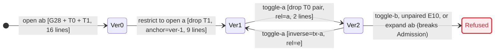
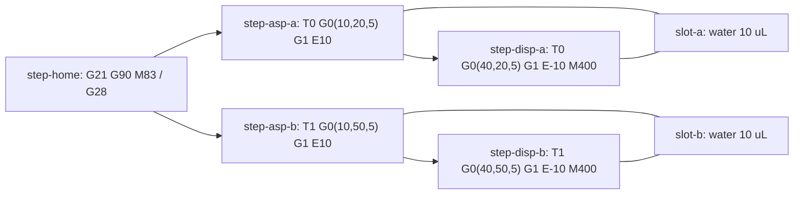

# `.pro`

A `.pro` file is an autonomous biomedical procedure graph whose robotic steps are written in word-address `.gcode`. In a stable environment, a presented group acts on the graph by plunger-conserving rewrites; across changing environments, a sheaf restricts the graph to a local procedure, and each realtime cycle returns a specification rather than commanding hardware.

```toml
[pro]
media_type       = "text/vnd.pro+markdown"
instruction_type = "text/x-gcode"
extension        = ".pro"
instruction      = ".gcode"
version          = "1.1.0"

[form]
domain         = "bio/med"
fields         = ["robotic", "synthetic"]
autonomous     = true
representation = "group"
object         = "graph"
prefer         = ".gcode"

[pipeline]
input   = "procedure, environment { updates, constraints, operators, hardware }, proposal"
process = "Loop(SENSE, graph.∆Transform, ACT) { invent-auto-procedure: group | adapt-procedure-locally: sheaf(environment) }"
output  = "new specification | local procedure | current specification --style .gcode"
users   = "agents"
```

## 1. Axioms

1. **Superset & traversal.** Every CommonMark `.md` or OpenGigantic `.og` file is a valid `.pro` link graph. Entry is `::index`; `:requires` loads a dependency; `::warning` is never skipped; `scope` gates visibility; graphs compose across `uri#id` edges. For a manifested procedure, the unique `version` with `current=true` is the read endpoint.
2. **Object & fields.** A procedure is a finite directed graph over `robotic` and `synthetic` steps; `:couples` is their only cross-field edge. A synthetic slot carries `payload-class` `empty` or `water`; `volume`, `unit`, and `vessel` are inert fixture metadata, not rewrite targets.
3. **`.gcode` instruction style.** Robotic steps express motion and metering as ISO 6983 / RS-274 word-address `.gcode` blocks (`N`, `G`, `M`, `T`, `X`, `Y`, `Z`, `E`, `F`, `P`, `S`), never free-form imperative prose. A conforming version linearizes enabled robotic steps along `:precedes` into a self-contained `.gcode` program whose modal preface (`G21`, `G90`, `M83`) and gantry homing (`G28`) precede all `G0`/`G1` moves, whose selected toolheads (`T0`, `T1`, ...) lie in the active open, whose intermediate plunger loads stay non-negative, and whose terminal plunger load returns to `0` (`M400`). Independent channel subprograms commute as a Mazurkiewicz trace; canonical emission orders branches by `::index` rank.
4. **Rewrite group.** Over `n` independent channels, autonomous writes in a stable environment form a right action of `Gamma_n ~= (Z/2Z)^n` (or a presented subgroup `Gamma`); identity `e` is a read. On the canonical two-channel carrier, `V4 = < toggle-a, toggle-b >` is the unique subgroup of the `2^5` five-step masks whose action preserves `.gcode` homing and zero plunger residual (`Delta E = +10` paired with `Delta E = -10`). On open `U`, admitted writes are the fiber-stabilizing subgroup `Gamma(U) = { g in Gamma | forall s in F(U), act(g, s) in F(U) }`.
5. **Environment sheaf.** Finite channel sets induce the locale `(P(C), <=)` (`none <= a, b <= ab` for `C = {a, b}`). A section `s in F(U)` pairs channel bits supported on `U` with the global `home` bit. Restriction `rho^U_V : F(U) -> F(V)` (`V <= U`) is contravariant, functorial, and idempotent, masking channels outside `V` while preserving `home` and `.gcode` validity. Sections on any cover `(U, V)` glue uniquely to `U cup V` iff they agree on `U cap V`; disagreement on `home` or on an overlap channel has no glue.
6. **Realtime loop.** One `Loop(SENSE, graph.∆Transform, ACT)` cycle senses one environment tuple `(updates, constraints, operators, hardware)` and one proposal, admits at most one transform, and acts once. `updates` are trace heartbeats: an updates-only sense with `id` is a `read`. Reads and refusals record trace events without allocating a version; an admitted write appends one immutable `version` naming its `parent`.
7. **Local adaptation.** When the snapshot `(hardware, operators, constraints)` changes from current open `U` to sensed open `V`, `adapt-procedure-locally` preempts the proposal. If `V <= U`, candidate `q = rho^U_V(current)` writes one `restrict` local procedure iff sensed operators cover `q`, sensed constraints accept `q`, and `q` is `.gcode`-valid on `V`; if `~Le(V, U)`, no canonical extension exists (`no-extension`); if operator or constraint checks fail, the result is `ill-formed-environment`.
8. **Version & anchor algebra.** Every version records an orbit `anchor` and relative group element `rel` satisfying `sec(v) = act(rel(v), sec(anchor(v)))`. A group toggle preserves `anchor`, stores its generator as `inverse`, and right-multiplies `rel`. A sheaf restriction has `inverse=none`, sets `anchor` to the new version, resets `rel=e`, and rolls back only via `parent`. Equality of generator words, group elements, sections, and version chains are four distinct relations.
9. **Scope & output boundary.** `agent` and `orchestrator` are provenance tags with identical admission (`ScopeParity`). The closed manifest grammar admits no sequence, organism, strain, toxin, patient identifier, diagnosis, treatment, or administration attribute, and `.gcode` words admit numeric addresses only. `ACT` returns a `.pro` specification and never drives a stage, executes a wet-lab protocol, or authorizes clinical use; [DISCLAIMER](DISCLAIMER) governs every read.

## 2. Ontology, G-Code & Rewrite Algebra (`lean`)

| Node | Role | Edge | Role |
|---|---|---|---|
| `procedure` | Graph root; names `current` version | `:contains` | Child vertex |
| `step` | Robotic `.gcode` block or synthetic slot | `:precedes` | Robotic `.gcode` partial order |
| `gate` | Section, `.gcode`, payload, or admission check | `:couples` | Robotic `.gcode` step to synthetic slot |
| `transform` | Group, generator, or sheaf restriction | `:acts` | Group generator acting on a version |
| `environment` | Updates, constraints, operators, hardware | `:restricts` | Sheaf restriction onto sensed environment |
| `version` | Immutable snapshot, `anchor`, and `.gcode` listing | `:writes` | Transform to produced version |
| `invariant` | Safety, conservation, or conformance check | `:senses` | Version to recorded environment |
| `meta` | Cycle `trace` or `__view` | `:inverts` | Generator to its inverse |
|  |  | `:supersedes` | Version to `parent` |
|  |  | `:requires` | Gate or invariant dependency |

The canonical rewrite group is

`V4 = < toggle-a, toggle-b | toggle-a^2 = toggle-b^2 = e, toggle-a * toggle-b = toggle-b * toggle-a >`,

acting on the right (`act(g * h, s) = act(h, act(g, s))`) as the `n = 2` specialization of `toggleN` on `(Z/2Z)^n`. Over the five robotic `.gcode` step blocks (`step-home`, `step-asp-a`, `step-disp-a`, `step-asp-b`, `step-disp-b`), `gcodeCharacterization` proves across all `4 * 2^5 = 128` `(open, mask)` pairs that a subset compiles to a homed, tool-supported, zero-residual `.gcode` program if and only if `home = true`, each channel's aspirate (`E10`) and dispense (`E-10`) toggle as one pair, and enabled toolheads lie in `open`.

```lean
inductive NodeType | procedure | step | gate | transform | environment | version | invariant | «meta»
  deriving DecidableEq, Repr
inductive EdgeType | contains | requires | precedes | couples | acts | restricts | inverts | writes | senses | supersedes
  deriving DecidableEq, Repr
inductive Field | robotic | synthetic
  deriving DecidableEq, Repr
inductive PayloadClass | empty | water
  deriving DecidableEq, Repr
inductive Scope | all | agent | orchestrator
  deriving DecidableEq, Repr
inductive Chan | a | b
  deriving DecidableEq, Repr
inductive Open | none | oa | ob | ab
  deriving DecidableEq, Repr

def toggleN : List Bool → List Bool → List Bool := List.zipWith bne
def restrictN : List Bool → List Bool → List Bool := List.zipWith (· && ·)
def leN (v u : List Bool) : Bool := (List.zip v u).all fun (x, y) => !x || y

def hasChan : Open → Chan → Bool
  | .oa, .a | .ab, .a | .ob, .b | .ab, .b => true
  | _, _ => false

def ofChans (ca cb : Bool) : Open :=
  match ca, cb with
  | false, false => .none
  | true,  false => .oa
  | false, true  => .ob
  | true,  true  => .ab

def le (v u : Open) : Bool :=
  (!hasChan v .a || hasChan u .a) && (!hasChan v .b || hasChan u .b)

def inter (u v : Open) : Open :=
  ofChans (hasChan u .a && hasChan v .a) (hasChan u .b && hasChan v .b)

def union (u v : Open) : Open :=
  ofChans (hasChan u .a || hasChan v .a) (hasChan u .b || hasChan v .b)

structure Sec where
  armA : Bool
  armB : Bool
  home : Bool
  deriving DecidableEq, Repr

def supported (u : Open) (s : Sec) : Bool :=
  (!s.armA || hasChan u .a) && (!s.armB || hasChan u .b)

def restrict (v : Open) (s : Sec) : Sec :=
  { armA := s.armA && hasChan v .a
  , armB := s.armB && hasChan v .b
  , home := s.home }

def glue (u v : Open) (su sv : Sec) : Option Sec :=
  if supported u su && supported v sv &&
     restrict (inter u v) su == restrict (inter u v) sv then
    some { armA := if hasChan u .a then su.armA else sv.armA
         , armB := if hasChan u .b then su.armB else sv.armB
         , home := su.home }
  else none

inductive Gen | toggleA | toggleB
  deriving DecidableEq, Repr

inductive G | e | a | b | ab
  deriving DecidableEq, Repr

def genElem : Gen → G
  | .toggleA => .a
  | .toggleB => .b

def mul : G → G → G
  | .e, g => g
  | g, .e => g
  | .a, .a => .e
  | .a, .b => .ab
  | .a, .ab => .b
  | .b, .a => .ab
  | .b, .b => .e
  | .b, .ab => .a
  | .ab, .a => .b
  | .ab, .b => .a
  | .ab, .ab => .e

def evalWord (w : List Gen) : G :=
  w.foldl (fun acc x => mul acc (genElem x)) .e

def act (g : G) (s : Sec) : Sec :=
  match g with
  | .e  => s
  | .a  => { s with armA := !s.armA }
  | .b  => { s with armB := !s.armB }
  | .ab => { s with armA := !s.armA, armB := !s.armB }

def inSubgroup (u : Open) : G → Bool
  | .e  => true
  | .a  => hasChan u .a
  | .b  => hasChan u .b
  | .ab => hasChan u .a && hasChan u .b

inductive GInstr
  | g21
  | g90
  | m83
  | g28
  | tool (c : Chan)
  | g0 (x y z f : Nat)
  | g1 (de : Int) (f : Nat)
  | m400
  deriving DecidableEq, Repr

structure Machine where
  metric : Bool
  absXYZ : Bool
  relE   : Bool
  homed  : Bool
  active : Option Chan
  x      : Nat
  y      : Nat
  z      : Nat
  loadA  : Int
  loadB  : Int
  deriving DecidableEq, Repr

def initMachine : Machine :=
  ⟨false, false, false, false, none, 0, 0, 0, 0, 0⟩

def stepInstr (u : Open) (m : Machine) : GInstr → Option Machine
  | .g21 => some { m with metric := true }
  | .g90 => some { m with absXYZ := true }
  | .m83 => some { m with relE := true }
  | .g28 =>
      if m.metric && m.absXYZ && m.relE then
        some { m with homed := true, x := 0, y := 0, z := 0, loadA := 0, loadB := 0 }
      else none
  | .tool c =>
      if m.homed && hasChan u c then some { m with active := some c } else none
  | .g0 x y z f =>
      if m.metric && m.absXYZ && m.homed && f > 0 then
        some { m with x := x, y := y, z := z }
      else none
  | .g1 de f =>
      if m.metric && m.absXYZ && m.relE && m.homed && f > 0 && de != 0 then
        match m.active with
        | some .a =>
            if 0 ≤ m.loadA + de then some { m with loadA := m.loadA + de } else none
        | some .b =>
            if 0 ≤ m.loadB + de then some { m with loadB := m.loadB + de } else none
        | none => none
      else none
  | .m400 =>
      match m.homed, m.active with
      | true, some .a => if m.loadA == 0 then some m else none
      | true, some .b => if m.loadB == 0 then some m else none
      | true, none    => some m
      | false, _      => none

def runProg (u : Open) (prog : List GInstr) : Option Machine :=
  prog.foldlM (stepInstr u) initMachine

def gcodeValid (u : Open) (prog : List GInstr) : Bool :=
  match runProg u prog with
  | some m => m.metric && m.absXYZ && m.relE && m.homed && m.loadA == 0 && m.loadB == 0
  | none   => false

def gHome  : List GInstr := [.g21, .g90, .m83, .g28]
def gAspA  : List GInstr := [.tool .a, .g0 10 20 5 3000, .g1 10 300]
def gDispA : List GInstr := [.tool .a, .g0 40 20 5 3000, .g1 (-10) 300, .m400]
def gAspB  : List GInstr := [.tool .b, .g0 10 50 5 3000, .g1 10 300]
def gDispB : List GInstr := [.tool .b, .g0 40 50 5 3000, .g1 (-10) 300, .m400]

def compileMask (h a1 a2 b1 b2 : Bool) : List GInstr :=
  (if h  then gHome  else []) ++
  (if a1 then gAspA  else []) ++
  (if a2 then gDispA else []) ++
  (if b1 then gAspB  else []) ++
  (if b2 then gDispB else [])

def compileSec (s : Sec) : List GInstr :=
  compileMask s.home s.armA s.armA s.armB s.armB

def compileSecBA (s : Sec) : List GInstr :=
  (if s.home then gHome else []) ++
  (if s.armB then gAspB ++ gDispB else []) ++
  (if s.armA then gAspA ++ gDispA else [])

inductive Proposal | id | restrict | toggle (g : Gen) | unpaired | other
  deriving DecidableEq, Repr

inductive Event
  | read | writeToggle (g : Gen) | writeRestrict
  | illFormed | notAdmitted | noExtension
  deriving DecidableEq, Repr

structure VerState where
  openSet   : Open
  sec       : Sec
  anchorSec : Sec
  rel       : G
  writes    : Nat
  events    : List Event
  deriving DecidableEq, Repr

def stepCycle (st : VerState) (sensed : Open) (prop : Proposal) (_sc : Scope) : VerState :=
  if sensed != st.openSet then
    if le sensed st.openSet then
      let q := restrict sensed st.sec
      { openSet := sensed, sec := q, anchorSec := q, rel := .e
      , writes := st.writes + 1, events := st.events ++ [.writeRestrict] }
    else
      { st with events := st.events ++ [.noExtension] }
  else
    match prop with
    | .id | .restrict => { st with events := st.events ++ [.read] }
    | .toggle g =>
        let elem := genElem g
        if inSubgroup st.openSet elem then
          { st with
            sec := act elem st.sec
            rel := mul st.rel elem
            writes := st.writes + 1
            events := st.events ++ [.writeToggle g] }
        else
          { st with events := st.events ++ [.notAdmitted] }
    | .unpaired | .other => { st with events := st.events ++ [.illFormed] }

def allGs    : List G    := [.e, .a, .b, .ab]
def allOpens : List Open := [.none, .oa, .ob, .ab]
def allBools : List Bool := [false, true]
def allSecs  : List Sec  :=
  allBools.flatMap fun a => allBools.flatMap fun b => allBools.map fun h => ⟨a, b, h⟩
def vecs3    : List (List Bool) :=
  allBools.flatMap fun x => allBools.flatMap fun y => allBools.map fun z => [x, y, z]

def nChanLaws : Bool :=
  vecs3.all fun g => vecs3.all fun h => vecs3.all fun s =>
    toggleN [false, false, false] s == s &&
    toggleN g (toggleN g s) == s &&
    toggleN (toggleN g h) s == toggleN h (toggleN g s) &&
    restrictN g (restrictN g s) == restrictN g s &&
    (!(leN g h) || restrictN g (restrictN h s) == restrictN g s)

def groupLaws : Bool :=
  allGs.all fun g =>
    mul .e g == g && mul g .e == g && mul g g == .e &&
    allGs.all fun h =>
      mul g h == mul h g &&
      (allGs.all fun k => mul (mul g h) k == mul g (mul h k)) &&
      (allSecs.all fun s =>
        act .e s == s &&
        act (mul g h) s == act h (act g s) &&
        (act g s).home == s.home) &&
    allOpens.all fun u =>
      inSubgroup u g == allSecs.all (fun s => !supported u s || supported u (act g s))

def sheafLaws : Bool :=
  allOpens.all fun u => allOpens.all fun v => allOpens.all fun w =>
    (allSecs.all fun s =>
      (!(le w v && le v u) || restrict w (restrict v s) == restrict w s) &&
      restrict v (restrict v s) == restrict v s &&
      supported v (restrict v s) &&
      (!supported (union u v) s || glue u v (restrict u s) (restrict v s) == some s)) &&
    (allSecs.all fun su => allSecs.all fun sv =>
      match glue u v su sv with
      | some g =>
          supported (union u v) g &&
          restrict u g == su &&
          restrict v g == sv &&
          (allSecs.filter (fun x =>
            supported (union u v) x && restrict u x == su && restrict v x == sv)) == [g]
      | none =>
          !(supported u su && supported v sv &&
            restrict (inter u v) su == restrict (inter u v) sv))

def gcodeCharacterization : Bool :=
  allOpens.all fun u =>
    allBools.all fun h =>
      allBools.all fun a1 => allBools.all fun a2 =>
        allBools.all fun b1 => allBools.all fun b2 =>
          gcodeValid u (compileMask h a1 a2 b1 b2) ==
            (h && a1 == a2 && b1 == b2 && supported u ⟨a1, b1, h⟩)

def gcodeTraceCommute : Bool :=
  allOpens.all fun u => allSecs.all fun s =>
    (!s.home || !supported u s) ||
      (gcodeValid u (compileSec s) &&
       gcodeValid u (compileSecBA s))

def sFull : Sec := ⟨true, true, true⟩
def v0    : VerState := ⟨.ab, sFull, sFull, .e, 0, []⟩

theorem v4_laws :
    nChanLaws = true ∧
    groupLaws = true ∧
    ([Gen.toggleA, Gen.toggleB] != [Gen.toggleB, Gen.toggleA]) = true ∧
    evalWord [.toggleA, .toggleB] = .ab ∧
    evalWord [.toggleB, .toggleA] = .ab ∧
    act .ab ⟨true, false, true⟩ = ⟨false, true, true⟩ := by decide

theorem sheaf_laws :
    sheafLaws = true ∧
    le .oa .ab = true ∧
    le .ab .oa = false ∧
    restrict .oa sFull = ⟨true, false, true⟩ ∧
    glue .oa .ob (restrict .oa sFull) (restrict .ob sFull) = some sFull ∧
    glue .oa .ob ⟨true, false, true⟩ ⟨false, true, false⟩ = none ∧
    glue .ab .oa sFull ⟨false, false, true⟩ = none := by decide

theorem gcode_laws :
    gcodeCharacterization = true ∧
    gcodeTraceCommute = true ∧
    gcodeValid .ab (gHome ++ gDispA ++ gAspA) = false ∧
    gcodeValid .oa (compileSec sFull) = false ∧
    gcodeValid .ab [.tool .a, .g0 10 20 5 3000] = false ∧
    gcodeValid .ab (gHome ++ [.tool .a, .g0 10 20 5 0]) = false := by decide

theorem cycle_laws :
    let p1 := stepCycle (stepCycle v0 .ab (.toggle .toggleB) .agent) .oa .id .agent
    let p2 := stepCycle (stepCycle v0 .oa .id .agent) .oa (.toggle .toggleB) .agent
    let cal := stepCycle (stepCycle v0 .oa (.toggle .toggleA) .agent) .oa (.toggle .toggleA) .agent
    p1.sec = p2.sec ∧
    p1.writes = 2 ∧
    p2.writes = 1 ∧
    p2.events = [.writeRestrict, .notAdmitted] ∧
    act cal.rel cal.anchorSec = cal.sec ∧
    cal.sec = ⟨false, false, true⟩ ∧
    gcodeValid cal.openSet (compileSec cal.sec) = true ∧
    stepCycle cal .oa .other .agent = stepCycle cal .oa .other .orchestrator := by decide
```

`[toggleA, toggleB]` and `[toggleB, toggleA]` are distinct words denoting the same element `ab` and the same section `(A off, B off, home on)`. Across adaptation, order becomes observationally non-commutative (`cycle_laws`): `toggle-b` then `restrict(a)` writes two versions, whereas `restrict(a)` then `toggle-b` writes one version and refuses the second (`not-admitted`), though both end at `(A on, B off, home on)`.

## 3. Grammar (`~EBNF`)

```ebnf
pro          = markdown_raw | manifest , { node_block | markdown_prose } ;
manifest     = "::meta"   , NL , { kv_line } , "::end" , NL ,
               "::schema" , NL , { kv_line } , "::end" , NL ,
               "::index"  , NL , { "#" , TEXT_LINE , NL | index_row } , "::end" , NL ;
kv_line      = id , ":" , WS , TEXT_LINE , NL ;
index_row    = id , WS , "|" , WS , node_type , WS , "|" , WS , scope , WS , "|" , WS , TEXT_LINE , NL ;
node_block   = "::node" , WS , "[" , attr , { WS , attr } , "]" , NL ,
               "::dense" , ( WS , TEXT_LINE , NL | NL , TEXT_LINE , NL , "::end" , NL ) ,
               { edge_decl | "::edges" , NL , { edge_decl } , "::end" , NL |
                 fenced_code | colon_block } ,
               "::end" , NL ;
attr         = attr_key , "=" , ( STRING | [ "-" ] , NUMBER | "true" | "false" | id_list ) ;
attr_key     = "id" | "type" | "scope" | "entry" | "current" | "field" | "style" |
               "operator" | "hardware" | "tool" | "payload-class" | "volume" |
               "unit" | "vessel" | "kind" | "presentation" | "element" | "writer" |
               "parent" | "anchor" | "transform" | "inverse" | "rel" | "open" | "enabled" ;
id_list      = id , { "," , id } ;
node_type    = "procedure" | "step" | "gate" | "transform" | "environment" |
               "version" | "invariant" | "meta" ;
scope        = "all" | "agent" | "orchestrator" ;
fenced_code  = "```" , ( "gcode" | "tla" | "lean" | "mermaid" | id ) , NL , VERBATIM , "```" , NL ;
colon_block  = "::" , id , [ WS , "[" , attr , { WS , attr } , "]" ] , NL ,
               VERBATIM , "::end" , NL ;
edge_decl    = ( "->" | "<-" | "<>" ) , "[:" , edge_type , { WS , attr } , "]" ,
               WS , target , { "," , [ WS ] , target } , NL ;
edge_type    = "contains" | "requires" | "precedes" | "couples" | "acts" |
               "restricts" | "inverts" | "writes" | "senses" | "supersedes" ;
target       = [ URI_PATH , "#" ] , id ;
id           = ( LETTER | "_" ) , { LETTER | DIGIT | "_" | "-" } ;
gcode_prog   = gcode_line , { gcode_line } ;
gcode_line   = [ "N" , NUMBER , WS ] , gcode_word , { WS , gcode_word } ,
               [ WS , ";" , TEXT_LINE ] , NL ;
gcode_word   = ( "G" | "M" | "T" | "X" | "Y" | "Z" | "E" | "F" | "P" | "S" ) ,
               [ "-" ] , NUMBER ;
```

The closed `attr_key` and `gcode_word` productions govern manifested `.pro` graphs: every robotic `step` embeds a `gcode` fence conforming to `gcode_prog`, and no attribute or executable word can encode a sequence, organism, strain, toxin, or patient identifier. Raw CommonMark remains a valid link graph under the superset axiom, but cannot set `current=true`.

## 4. Realtime & Local Adaptation Logic (`tla`)

Each cycle evaluates `Admit` deterministically over the four environment components (`updates`, `constraints`, `operators`, `hardware`), one proposal, and caller `scope`. `hardware` induces open `V`; `updates` (`upd`) are trace heartbeats excluded from snapshot equality; `operators` (`ops`), `constraints` (`policy`), and `.gcode` plunger conservation (`GCodeValid`) are checked on the candidate marking `(x', y')`:

| Snapshot `(V, ops', policy')` | Proposal | Condition on candidate `q` | Result |
|---|---|---|---|
| `= (U, ops, policy)` (including `upd` change) | `id` or `restrict` | current state | `read` |
| `= (U, ops, policy)` | `toggle-a` | `HasA(U) /\ Covers(ops, q) /\ PolicyOK(policy, q) /\ GCodeValid(U, q)` | `write-toggle-a` |
| `= (U, ops, policy)` | `toggle-a` | well-formed toggle failing open, operator, or policy gate | `not-admitted` |
| `= (U, ops, policy)` | `toggle-b` | `HasB(U) /\ Covers(ops, q) /\ PolicyOK(policy, q) /\ GCodeValid(U, q)` | `write-toggle-b` |
| `= (U, ops, policy)` | `toggle-b` | well-formed toggle failing open, operator, or policy gate | `not-admitted` |
| `= (U, ops, policy)` | `unpaired-gcode`, `other`, or payload outside `empty`, `water` | any | `ill-formed` |
| `# (U, ops, policy)` with `V <= U` | any (preempted) | `q = Restrict(V, a, b)` passes `Covers`, `PolicyOK`, `GCodeValid` | `write-restrict` |
| `# (U, ops, policy)` with `V <= U` | any (preempted) | `q = Restrict(V, a, b)` fails `Covers` or `PolicyOK` | `ill-formed-environment` |
| `# (U, ops, policy)` with `~Le(V, U)` | any (preempted) | larger or incomparable open | `no-extension` |

```tla
---- MODULE ProKernel ----
EXTENDS Integers, FiniteSets

Opens      == {"none", "a", "b", "ab"}
Ops        == {"home", "aspirate", "dispense"}
Policies   == {"pairing", "single"}
Proposals  == {"id", "restrict", "toggle-a", "toggle-b", "unpaired-gcode", "other"}
Scopes     == {"agent", "orchestrator"}
Transforms == {"id", "toggle-a", "toggle-b", "restrict"}
Relations  == {"e", "a", "b", "ab"}
Events == {
  "init", "read", "write-toggle-a", "write-toggle-b", "write-restrict",
  "ill-formed", "not-admitted", "ill-formed-environment", "no-extension"
}

HasA(u) == u \in {"a", "ab"}
HasB(u) == u \in {"b", "ab"}

Le(v, u) ==
  /\ (HasA(v) => HasA(u))
  /\ (HasB(v) => HasB(u))

Restrict(v, x, y) ==
  <<IF x = 1 /\ HasA(v) THEN 1 ELSE 0,
    IF y = 1 /\ HasB(v) THEN 1 ELSE 0>>

Supported(u, x, y) ==
  /\ x \in 0..1
  /\ y \in 0..1
  /\ (x = 0 \/ HasA(u))
  /\ (y = 0 \/ HasB(u))

Covers(os, x, y) ==
  /\ "home" \in os
  /\ ((x = 1 \/ y = 1) => {"aspirate", "dispense"} \subseteq os)

PolicyOK(p, x, y) ==
  CASE p = "pairing" -> TRUE
    [] p = "single"  -> x + y <= 1

PlungerResidual(asp, disp) == 10 * asp - 10 * disp

GCodeValid(u, h, aspA, dispA, aspB, dispB) ==
  /\ h = 1
  /\ (aspA = 1 \/ dispA = 1 => HasA(u))
  /\ (aspB = 1 \/ dispB = 1 => HasB(u))
  /\ PlungerResidual(aspA, dispA) >= 0
  /\ PlungerResidual(aspB, dispB) >= 0
  /\ PlungerResidual(aspA, dispA) = 0
  /\ PlungerResidual(aspB, dispB) = 0

Mul(g, h) ==
  CASE g = "e" -> h
    [] h = "e" -> g
    [] g = h -> "e"
    [] {g, h} = {"a", "b"} -> "ab"
    [] {g, h} = {"a", "ab"} -> "b"
    [] {g, h} = {"b", "ab"} -> "a"

Act(g, x, y) ==
  CASE g = "e"  -> <<x, y>>
    [] g = "a"  -> <<1 - x, y>>
    [] g = "b"  -> <<x, 1 - y>>
    [] g = "ab" -> <<1 - x, 1 - y>>

Admit(u, x, y, os, pol, v, newOps, newPol, prop, sc) ==
  IF sc \notin Scopes THEN "ill-formed"
  ELSE IF <<v, newOps, newPol>> # <<u, os, pol>> THEN
    IF ~Le(v, u) THEN "no-extension"
    ELSE LET q == Restrict(v, x, y)
         IN IF Covers(newOps, q[1], q[2]) /\ PolicyOK(newPol, q[1], q[2])
               /\ GCodeValid(v, 1, q[1], q[1], q[2], q[2])
            THEN "write-restrict"
            ELSE "ill-formed-environment"
  ELSE
    CASE prop \in {"id", "restrict"} -> "read"
      [] prop = "toggle-a" ->
           IF HasA(u) /\ Covers(os, 1 - x, y) /\ PolicyOK(pol, 1 - x, y)
              /\ GCodeValid(u, 1, 1 - x, 1 - x, y, y)
           THEN "write-toggle-a"
           ELSE "not-admitted"
      [] prop = "toggle-b" ->
           IF HasB(u) /\ Covers(os, x, 1 - y) /\ PolicyOK(pol, x, 1 - y)
              /\ GCodeValid(u, 1, x, x, 1 - y, 1 - y)
           THEN "write-toggle-b"
           ELSE "not-admitted"
      [] OTHER -> "ill-formed"

VARIABLES open, a, b, ops, policy, upd, priorUpd, version, priorVersion,
          anchorVersion, parentA, parentB, anchorA, anchorB,
          transform, rel, event, scope

vars == <<open, a, b, ops, policy, upd, priorUpd, version, priorVersion,
          anchorVersion, parentA, parentB, anchorA, anchorB,
          transform, rel, event, scope>>

TypeOK ==
  /\ open \in Opens
  /\ a \in 0..1
  /\ b \in 0..1
  /\ ops \in SUBSET Ops
  /\ policy \in Policies
  /\ upd \in 0..1
  /\ priorUpd \in 0..1
  /\ version \in 0..3
  /\ priorVersion \in 0..3
  /\ anchorVersion \in 0..3
  /\ parentA \in 0..1
  /\ parentB \in 0..1
  /\ anchorA \in 0..1
  /\ anchorB \in 0..1
  /\ transform \in Transforms
  /\ rel \in Relations
  /\ event \in Events
  /\ scope \in Scopes

SectionOK     == Supported(open, a, b)
OperatorOK    == Covers(ops, a, b)
ConstraintOK  == PolicyOK(policy, a, b)
InstructionOK == GCodeValid(open, 1, a, a, b, b)

GCodeSubgroupLaw ==
  \A h, a1, a2, b1, b2 \in 0..1 :
    GCodeValid(open, h, a1, a2, b1, b2) <=>
      (h = 1 /\ a1 = a2 /\ b1 = b2 /\ Supported(open, a1, b1))

VersionLaw ==
  /\ (event = "init" => version = 0 /\ priorVersion = 0 /\ anchorVersion = 0)
  /\ (event \in {"read", "ill-formed", "not-admitted",
                  "ill-formed-environment", "no-extension"}
      => version = priorVersion)
  /\ (event \in {"write-toggle-a", "write-toggle-b", "write-restrict"}
      => version = priorVersion + 1)

ParentLaw ==
  /\ (transform = "id" => version = 0)
  /\ (transform = "toggle-a" => parentA = 1 - a /\ parentB = b)
  /\ (transform = "toggle-b" => parentA = a /\ parentB = 1 - b)
  /\ (transform = "restrict" =>
        a <= parentA /\ b <= parentB /\ rel = "e" /\ anchorVersion = version)

AnchorLaw ==
  /\ anchorVersion <= version
  /\ Supported(open, anchorA, anchorB)
  /\ Act(rel, anchorA, anchorB) = <<a, b>>

HeartbeatLaw ==
  (event = "read" /\ upd # priorUpd) => version = priorVersion

ScopeParity ==
  \A v \in Opens, os \in SUBSET Ops, p \in Policies, pr \in Proposals :
    Admit(open, a, b, ops, policy, v, os, p, pr, "agent") =
    Admit(open, a, b, ops, policy, v, os, p, pr, "orchestrator")

PreemptLaw ==
  \A v \in Opens, os \in SUBSET Ops, p \in Policies, pr \in Proposals, sc \in Scopes :
    <<v, os, p>> # <<open, ops, policy>> =>
      Admit(open, a, b, ops, policy, v, os, p, pr, sc) \in
        {"write-restrict", "no-extension", "ill-formed-environment"}

Hold(out, newUpd, sc) ==
  /\ priorVersion' = version
  /\ priorUpd' = upd
  /\ upd' = newUpd
  /\ event' = out
  /\ scope' = sc
  /\ UNCHANGED <<open, a, b, ops, policy, version, anchorVersion,
                 parentA, parentB, anchorA, anchorB, transform, rel>>

Cycle(v, newOps, newPol, newUpd, prop, sc) ==
  LET out == Admit(open, a, b, ops, policy, v, newOps, newPol, prop, sc)
      q   == Restrict(v, a, b)
  IN CASE out = "write-restrict" ->
            /\ version < 3
            /\ parentA' = a
            /\ parentB' = b
            /\ a' = q[1]
            /\ b' = q[2]
            /\ anchorA' = q[1]
            /\ anchorB' = q[2]
            /\ open' = v
            /\ ops' = newOps
            /\ policy' = newPol
            /\ priorUpd' = upd
            /\ upd' = newUpd
            /\ version' = version + 1
            /\ priorVersion' = version
            /\ anchorVersion' = version + 1
            /\ transform' = "restrict"
            /\ rel' = "e"
            /\ event' = out
            /\ scope' = sc
       [] out = "write-toggle-a" ->
            /\ version < 3
            /\ parentA' = a
            /\ parentB' = b
            /\ a' = 1 - a
            /\ b' = b
            /\ priorUpd' = upd
            /\ upd' = newUpd
            /\ version' = version + 1
            /\ priorVersion' = version
            /\ transform' = "toggle-a"
            /\ rel' = Mul(rel, "a")
            /\ event' = out
            /\ scope' = sc
            /\ UNCHANGED <<open, ops, policy, anchorVersion, anchorA, anchorB>>
       [] out = "write-toggle-b" ->
            /\ version < 3
            /\ parentA' = a
            /\ parentB' = b
            /\ a' = a
            /\ b' = 1 - b
            /\ priorUpd' = upd
            /\ upd' = newUpd
            /\ version' = version + 1
            /\ priorVersion' = version
            /\ transform' = "toggle-b"
            /\ rel' = Mul(rel, "b")
            /\ event' = out
            /\ scope' = sc
            /\ UNCHANGED <<open, ops, policy, anchorVersion, anchorA, anchorB>>
       [] OTHER ->
            Hold(out, newUpd, sc)

Init ==
  /\ open = "ab"
  /\ a = 1
  /\ b = 1
  /\ ops = Ops
  /\ policy = "pairing"
  /\ upd = 0
  /\ priorUpd = 0
  /\ version = 0
  /\ priorVersion = 0
  /\ anchorVersion = 0
  /\ parentA = 1
  /\ parentB = 1
  /\ anchorA = 1
  /\ anchorB = 1
  /\ transform = "id"
  /\ rel = "e"
  /\ event = "init"
  /\ scope = "agent"

Next ==
  \E v \in Opens, os \in SUBSET Ops, p \in Policies,
     u \in 0..1, pr \in Proposals, sc \in Scopes :
    Cycle(v, os, p, u, pr, sc)

Spec == Init /\ [][Next]_vars
====
```

`TypeOK`, `SectionOK`, `OperatorOK`, `ConstraintOK`, `InstructionOK`, `GCodeSubgroupLaw`, `VersionLaw`, `ParentLaw`, `AnchorLaw`, `HeartbeatLaw`, `ScopeParity`, and `PreemptLaw` are invariants across the bounded check (`version <= 3`, a model-checking horizon rather than a format limit).

## 5. Canonical Instantiation (`CAL-1937-001`)

`CAL-1937-001` is a synthetic two-channel (`T0`, `T1`) water-calibration graph in `.gcode` instruction style. `ver-0` emits the 16-line two-channel `.gcode` program (`N10..N160`); a channel-B fault restricts `ver-0` to `ver-1` on open `a` (`N10..N90`, dropping `T1` without retargeting); a subsequent `toggle-a` writes `ver-2` (`N10..N20`, gantry homing only).

````markdown
::meta
title: CAL-1937-001
version: 1.1.0
fixture: CAL-1937-001
domain: bio/med
fields: robotic|synthetic
instruction: .gcode
scope: all
::end

::schema
node-types: [procedure, step, gate, transform, environment, version, invariant, meta]
edge-types: [contains, requires, precedes, couples, acts, restricts, inverts, writes, senses, supersedes]
fields: [robotic, synthetic]
instruction-style: gcode
opens: [none, a, b, ab]
tools: [T0, T1]
payload-classes: [empty, water]
scopes: [all, agent, orchestrator]
::end

::index
# id | type | scope | keywords
proc | procedure | all | calibration, water, gcode, two-channel, current=ver-2
grp-v4 | transform | all | group, V4, toggle-a, toggle-b, plunger-conserving
tx-a | transform | all | generator, a, T0, inverse=tx-a
tx-b | transform | all | generator, b, T1, inverse=tx-b
tx-restrict | transform | all | sheaf, restriction, local-procedure, no-inverse
env-0 | environment | all | hardware A B, tools T0 T1, open ab
env-1 | environment | all | hardware A, tool T0, channel-b-fault, open a
step-home | step | all | robotic, gcode, G21, G90, M83, G28
step-asp-a | step | all | robotic, gcode, T0, aspirate, E10
step-disp-a | step | all | robotic, gcode, T0, dispense, E-10, M400
step-asp-b | step | all | robotic, gcode, T1, aspirate, E10
step-disp-b | step | all | robotic, gcode, T1, dispense, E-10, M400
slot-a | step | all | synthetic, water, 10uL, source-target-a
slot-b | step | all | synthetic, water, 10uL, source-target-b
gate-section | gate | all | support, pairing, gcode-plunger-zero
gate-payload | gate | all | empty, water, numeric-gcode-words
inv-runtime | invariant | all | one-transform, gcode-valid, anchor-orbit, scope-parity
ver-0 | version | all | anchor=ver-0, open ab, N10..N160
ver-1 | version | all | restrict, anchor=ver-1, open a, N10..N90
ver-2 | version | all | toggle-a, anchor=ver-1, open a, current, N10..N20
trace | meta | all | six-cycles, preemption, scope-parity
__view | meta | all | mermaid, stateDiagram-v2, flowchart
::end

::node [id=proc type=procedure scope=all entry=true style=gcode current=ver-2]
::dense CAL-1937-001|water-calibration|style=gcode|group=V4|sheaf=hardware
::warning
Read DISCLAIMER before any node. ACT returns a .pro specification and .gcode listing; it never drives hardware.
::end
->[:contains] grp-v4, tx-restrict, env-0, env-1, step-home, step-asp-a, step-disp-a, step-asp-b, step-disp-b, slot-a, slot-b, gate-section, gate-payload, inv-runtime, ver-0, ver-1, ver-2, trace, __view
::end

::node [id=grp-v4 type=transform scope=all kind=group presentation=V4]
::dense e,a,b,ab|a^2=b^2=e|ab=ba|right-action|preserves-net-E-zero
->[:contains] tx-a, tx-b
::end

::node [id=tx-a type=transform scope=all kind=generator element=a tool=T0 inverse=tx-a]
::dense toggle-a|toggles step-asp-a+step-disp-a|net-E=0
->[:inverts] tx-a
->[:acts] ver-1
->[:writes] ver-2
::end

::node [id=tx-b type=transform scope=all kind=generator element=b tool=T1 inverse=tx-b]
::dense toggle-b|toggles step-asp-b+step-disp-b|net-E=0
->[:inverts] tx-b
::end

::node [id=tx-restrict type=transform scope=all kind=sheaf inverse=none]
::dense adapt-procedure-locally|drops-unsupported-tool-blocks|resets-anchor
->[:restricts] env-1
->[:writes] ver-1
::end

::node [id=env-0 type=environment scope=all open=ab]
::dense hardware=A,B|tools=T0,T1|operators=home,aspirate,dispense|constraints=pairing,channels-not-isomorphic|updates=empty
::end

::node [id=env-1 type=environment scope=all open=a]
::dense hardware=A|tools=T0|operators=home,aspirate,dispense|constraints=pairing,channels-not-isomorphic|updates=channel-b-fault
::end

::node [id=step-home type=step scope=all field=robotic style=gcode operator=home hardware=none]
::dense G21+G90+M83+G28|enabled-in-every-conforming-version
->[:precedes] step-asp-a, step-asp-b
```gcode
N10 G21 G90 M83 ; mm, abs-xyz, rel-e
N20 G28 X0 Y0 Z0 ; home gantry
```
::end

::node [id=step-asp-a type=step scope=all field=robotic style=gcode operator=aspirate hardware=a tool=T0]
::dense T0|source=(10,20,5)|E10|paired-with=step-disp-a
->[:precedes] step-disp-a
->[:couples] slot-a
```gcode
N10 T0 ; select channel-a
N20 G0 X10 Y20 Z5 F3000 ; rapid slot-a source
N30 G1 E10 F300 ; aspirate 10 uL water
```
::end

::node [id=step-disp-a type=step scope=all field=robotic style=gcode operator=dispense hardware=a tool=T0]
::dense T0|target=(40,20,5)|E-10|M400|paired-with=step-asp-a
->[:couples] slot-a
```gcode
N10 T0 ; select channel-a
N20 G0 X40 Y20 Z5 F3000 ; rapid slot-a target
N30 G1 E-10 F300 ; dispense 10 uL water
N40 M400 ; sync channel-a
```
::end

::node [id=step-asp-b type=step scope=all field=robotic style=gcode operator=aspirate hardware=b tool=T1]
::dense T1|source=(10,50,5)|E10|paired-with=step-disp-b
->[:precedes] step-disp-b
->[:couples] slot-b
```gcode
N10 T1 ; select channel-b
N20 G0 X10 Y50 Z5 F3000 ; rapid slot-b source
N30 G1 E10 F300 ; aspirate 10 uL water
```
::end

::node [id=step-disp-b type=step scope=all field=robotic style=gcode operator=dispense hardware=b tool=T1]
::dense T1|target=(40,50,5)|E-10|M400|paired-with=step-asp-b
->[:couples] slot-b
```gcode
N10 T1 ; select channel-b
N20 G0 X40 Y50 Z5 F3000 ; rapid slot-b target
N30 G1 E-10 F300 ; dispense 10 uL water
N40 M400 ; sync channel-b
```
::end

::node [id=slot-a type=step scope=all field=synthetic payload-class=water volume=10 unit=uL vessel=calibration-plate]
::dense slot-a|water|10uL|inert
::end

::node [id=slot-b type=step scope=all field=synthetic payload-class=water volume=10 unit=uL vessel=calibration-plate]
::dense slot-b|water|10uL|inert
::end

::node [id=gate-section type=gate scope=all]
::dense tool-in-open|G28-before-motion|E10-paired-with-E-10
::warning
A .gcode block whose toolhead lies outside the sensed open is dropped, never retargeted from T1 onto T0.
::end
->[:requires] env-0, env-1
::end

::node [id=gate-payload type=gate scope=all]
::dense payload-class in empty,water|closed-attr-and-gcode-words
::warning
The format has no attribute or .gcode word for a sequence, organism, strain, toxin, patient identifier, diagnosis, treatment, or administration. Orchestrator scope adds none.
::end
::end

::node [id=inv-runtime type=invariant scope=all kind=safety]
::dense one-cycle-one-admission|gcode-valid|anchor-orbit|scope-parity
->[:requires] gate-section, gate-payload
```tla
Cal1937OK ==
  /\ Admit("ab", 1, 1, Ops, "pairing", "ab", Ops, "pairing", "id", "agent") = "read"
  /\ Admit("ab", 1, 1, Ops, "pairing", "a", Ops, "pairing", "toggle-a", "agent") = "write-restrict"
  /\ Restrict("a", 1, 1) = <<1, 0>>
  /\ Admit("a", 1, 0, Ops, "pairing", "a", Ops, "pairing", "toggle-a", "agent") = "write-toggle-a"
  /\ Act("a", 1, 0) = <<0, 0>>
  /\ Admit("a", 0, 0, Ops, "pairing", "a", Ops, "pairing", "toggle-b", "agent") = "not-admitted"
  /\ Admit("a", 0, 0, Ops, "pairing", "a", Ops, "pairing", "unpaired-gcode", "agent") =
     Admit("a", 0, 0, Ops, "pairing", "a", Ops, "pairing", "unpaired-gcode", "orchestrator")
```
::end

::node [id=ver-0 type=version scope=all style=gcode current=false writer=none parent=none anchor=ver-0 transform=id inverse=none rel=e open=ab enabled=step-home,step-asp-a,step-disp-a,step-asp-b,step-disp-b]
::dense A=on|B=on|anchor=ver-0|rel=e|lines=16
->[:senses] env-0
```gcode
N10 G21 G90 M83
N20 G28 X0 Y0 Z0
N30 T0
N40 G0 X10 Y20 Z5 F3000
N50 G1 E10 F300
N60 T0
N70 G0 X40 Y20 Z5 F3000
N80 G1 E-10 F300
N90 M400
N100 T1
N110 G0 X10 Y50 Z5 F3000
N120 G1 E10 F300
N130 T1
N140 G0 X40 Y50 Z5 F3000
N150 G1 E-10 F300
N160 M400
```
::end

::node [id=ver-1 type=version scope=all style=gcode current=false writer=agent parent=ver-0 anchor=ver-1 transform=restrict inverse=none rel=e open=a enabled=step-home,step-asp-a,step-disp-a]
::dense A=on|B=off|local-procedure|anchor=ver-1|rollback=ver-0|lines=9
::warning
Tool T1 is outside open a. Restriction drops step-asp-b and step-disp-b; never rewrite T1 as T0.
::end
->[:senses] env-1
->[:supersedes] ver-0
```gcode
N10 G21 G90 M83
N20 G28 X0 Y0 Z0
N30 T0
N40 G0 X10 Y20 Z5 F3000
N50 G1 E10 F300
N60 T0
N70 G0 X40 Y20 Z5 F3000
N80 G1 E-10 F300
N90 M400
```
::end

::node [id=ver-2 type=version scope=all style=gcode current=true writer=agent parent=ver-1 anchor=ver-1 transform=toggle-a inverse=tx-a rel=a open=a enabled=step-home]
::dense A=off|B=off|current|anchor=ver-1|rel=a|slots-retained|lines=2
->[:senses] env-1
->[:supersedes] ver-1
```gcode
N10 G21 G90 M83
N20 G28 X0 Y0 Z0
```
::end

::node [id=trace type=meta scope=all]
::dense six-cycles|two-writes|preemption|scope-parity
::table
cycle|sense|proposal|witness|version
0|env-0 stable|id|read|ver-0
1|env-1 descends (open a)|toggle-a|write:restrict (preempts proposal)|ver-1
2|env-1 stable|toggle-a|write:toggle-a|ver-2
3|env-1 stable|toggle-b, agent|not-admitted (T1 outside open a)|ver-2 held
4|env-1 stable|unpaired-gcode, agent|ill-formed (net E != 0)|ver-2 held
5|env-1 stable|unpaired-gcode, orchestrator|ill-formed (scope parity)|ver-2 held
::end
::end

::node [id=__view type=meta scope=all]
::dense mermaid|stateDiagram-v2+flowchart


::end
````


The type graph retains both channels (`T0`, `T1`) and both synthetic water slots (`slot-a`, `slot-b`). `ver-2` is `current=true` and emits `N10..N20` (`step-home` only); applying its stored `inverse=tx-a` reconstructs `ver-1` via `act(rel, anchorSec)`, whereas the sheaf restriction from `ver-0` to `ver-1` has no group inverse.

## 6. Falsification

Each row is a challenge. The failure signal is what a conforming read returns.

| Challenge | Failure signal |
|---|---|
| Write a robotic step in free-form prose, omit `G21 G90 M83` + `G28`, or set feedrate `F0` | Grammar requires a `gcode` block matching `gcode_prog`; `gcodeValid` rejects unhomed moves and `f = 0`. |
| Toggle `step-asp-a` (`G1 E10`) without `step-disp-a` (`G1 E-10`), or reverse `:precedes` (`disp-a` before `asp-a`) | `gcodeCharacterization` and `GCodeSubgroupLaw` reject `a1 != a2` (`PlungerResidual = 10 # 0`); `gDispA ++ gAspA` fails `0 <= loadA + (-10)`. |
| Confuse Mazurkiewicz channel commutation with adaptation commutation | `compileSec` (`T0` then `T1`) and `compileSecBA` (`T1` then `T0`) both pass `gcodeTraceCommute` on `ab`, whereas `toggle-b; restrict(a)` writes `2` versions and `restrict(a); toggle-b` writes `1` then `not-admitted`. |
| Store a toggle version without `inverse`, or read `rel=e` after `restrict` as erasing history | Toggle versions require generator `inverse`; `restrict` resets `anchor` to itself (`AnchorLaw`) while `parent` retains prior transforms. |
| Restrict to open `a` twice expecting `T1` to return, or expand from `a` to `ab` / incomparable `b` | Restriction is idempotent (`B` stays off); `~Le(v, open)` yields `no-extension` and holds the version. |
| Propose `toggle-b` on open `ab` under `policy = "single"` while `A` is enabled, or drop `dispense` from `ops` while `A` stays on | `Admit` returns `not-admitted` when `PolicyOK("single", 1, 1)` fails on `ab`, and `ill-formed-environment` when `Covers` fails on descent. |
| Let an `ill-formed` or `toggle-a` proposal block a valid hardware descent | `PreemptLaw` holds: `adapt-procedure-locally` preempts the proposal and writes `restrict`. |
| Retarget `T1` blocks onto `T0`, or glue sections disagreeing on `home` or an overlap channel | `gcodeValid .oa (compileSec sFull) = false`; `glue .oa .ob` with mismatched `home` and `glue .ab .oa` with mismatched `armA` both return `none`. |
| Allocate a version on an `updates`-only heartbeat, or admit two transforms in one cycle | `HeartbeatLaw` keeps `version = priorVersion` (`event = "read"`); `Cycle` admits at most one transform. |
| Escalate privilege via `scope=orchestrator`, smuggle a sequence/organism/toxin/patient token into attributes or `.gcode` words, skip `::warning`, or treat `ACT` as hardware execution | `ScopeParity` equates `agent` and `orchestrator`; closed `attr_key` and numeric `gcode_word` reject non-conformant tokens; skipping `::warning` invalidates traversal; `ACT` returns a specification under `DISCLAIMER`. |

`v4_laws`, `sheaf_laws`, `gcode_laws`, and `cycle_laws` (`Lean 4.35.0`), together with `TypeOK`, `SectionOK`, `OperatorOK`, `ConstraintOK`, `InstructionOK`, `GCodeSubgroupLaw`, `VersionLaw`, `ParentLaw`, `AnchorLaw`, `HeartbeatLaw`, `ScopeParity`, `PreemptLaw`, and `Cal1937OK` (`SANY` + `TLC2`), are the discharged checks.

## References

1. International Organization for Standardization, *ISO 6983-1: Automation systems and integration — Numerical control of machines — Program format and definitions of address words — Part 1*, 2009; T. R. Kramer, F. M. Proctor, and E. Messina, [*The NIST RS274NGC Interpreter — Version 3*](https://doi.org/10.6028/NIST.IR.6556), NISTIR 6556, 2000.
2. Saunders Mac Lane and Ieke Moerdijk, [*Sheaves in Geometry and Logic*](https://doi.org/10.1007/978-1-4612-0927-0), Springer, 1992.
3. Joseph A. Goguen, ["Sheaf Semantics for Concurrent Interacting Objects"](https://doi.org/10.1017/S0960129500001420), *Mathematical Structures in Computer Science* 2 (1992) 159–191.
4. Vincent Danos and Jean Krivine, ["Reversible Communicating Systems"](https://doi.org/10.1007/978-3-540-28644-8_19), CONCUR 2004, LNCS 3170, 292–307.
5. Antoni Mazurkiewicz, ["Introduction to Trace Theory"](https://doi.org/10.1142/9789814261456_0001), in V. Diekert and G. Rozenberg (eds.), *The Book of Traces*, World Scientific, 1995.
6. M. Dubey, [*ObjectGraph* (`arXiv:2604.27820v1`)](https://arxiv.org/html/2604.27820v1), 2026.
7. [CommonMark 0.31.2](https://spec.commonmark.org/0.31.2/).
8. Sibling graph specifications, [wetware-hq/chart](https://github.com/wetware-hq/chart) and [wetware-hq/figure](https://github.com/wetware-hq/figure).

## License

MIT — see [LICENSE](LICENSE).
